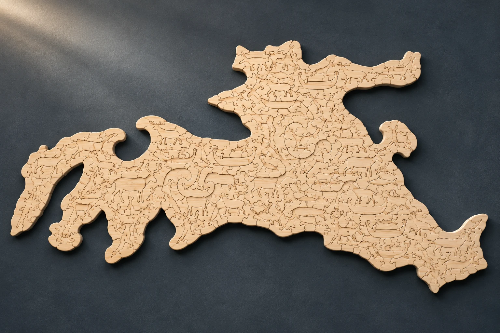
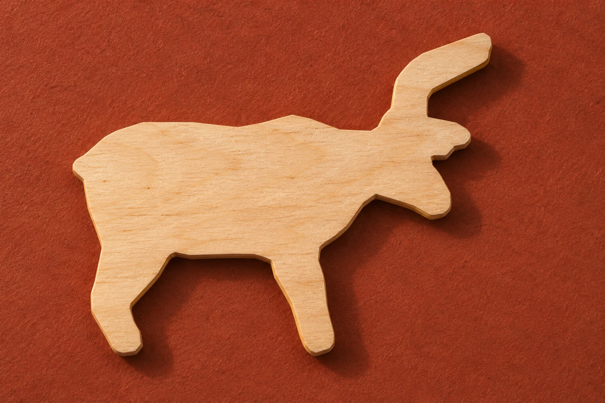
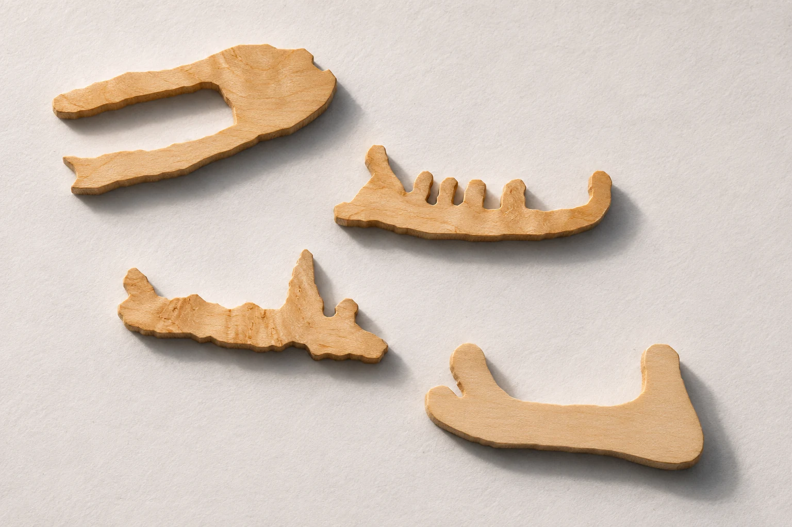
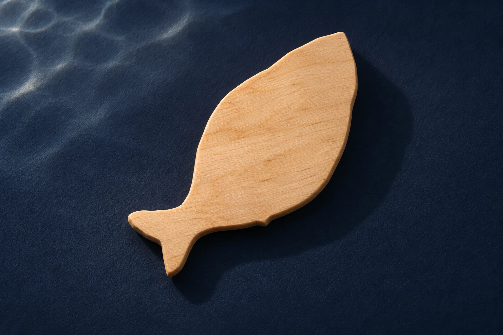
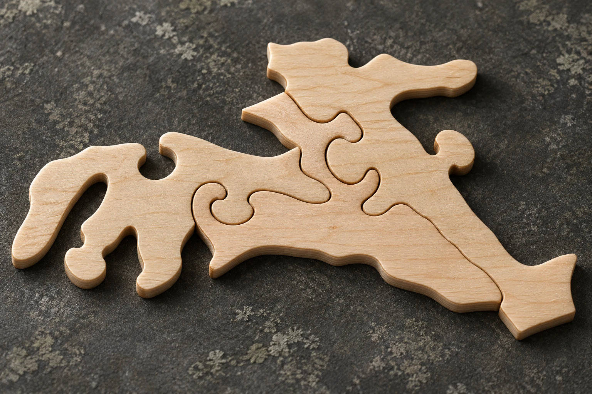
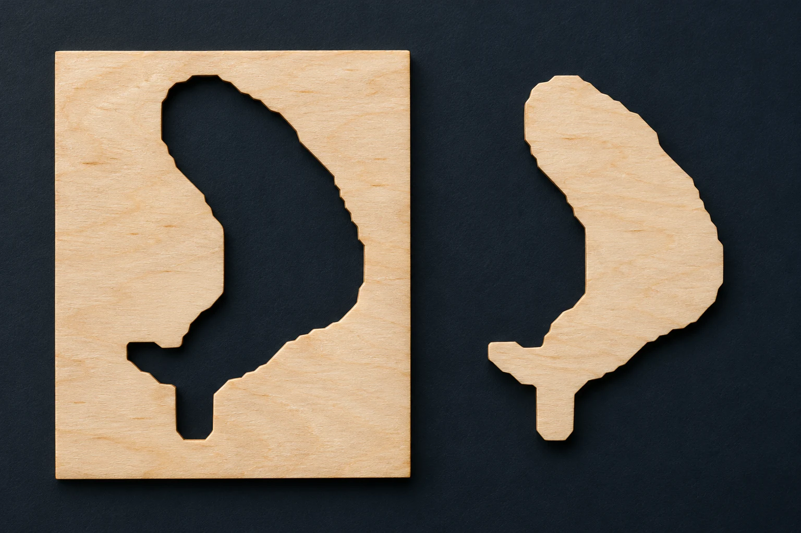
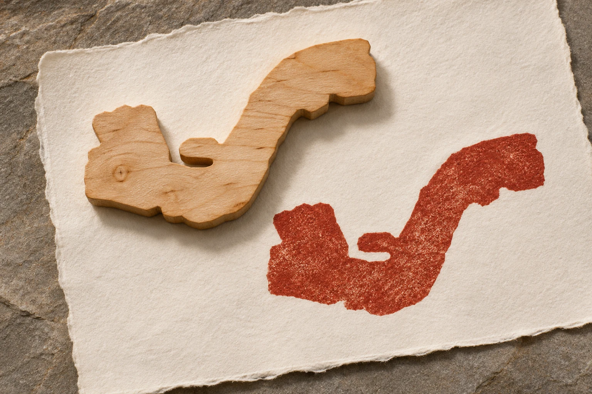
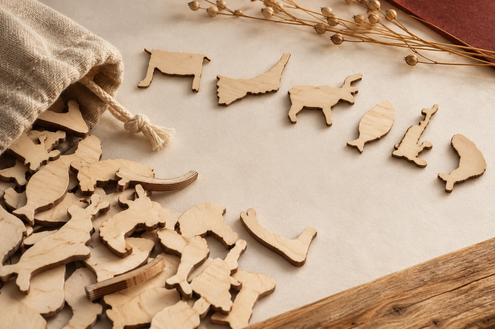
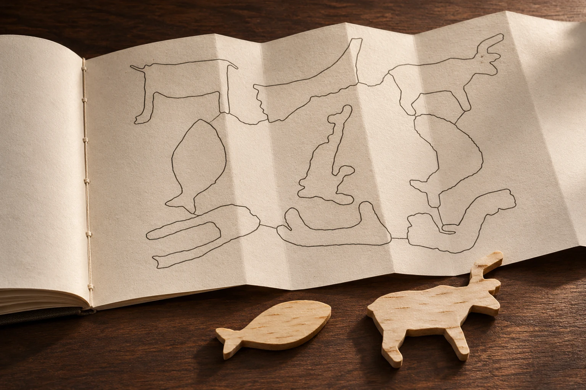
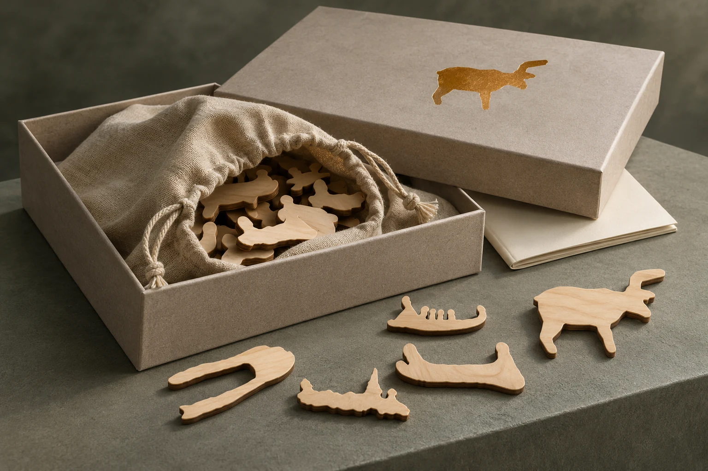

# Helleristningar · Product studies 01

Ten generated product images explore the 750-piece Nordic rock-art jigsaw in birch, from individual motifs and cut edges to its collector’s box. Study 01 is a speculative board and perimeter. Study 09 explores a fold-out motif guide. Their layouts are illustrative. The edition brief specifies an irregular 971.6 × 656.5 mm perimeter, an A5 guide and a rigid two-part box. [Edition and packaging brief](../../packaging-alignment.md)

| | |
|---|---|
| [Speculative board and perimeter on slate](01-board-on-slate.webp)  | [Bøla reindeer](02-bola-reindeer.webp)  |
| [Ship silhouettes](03-ship-typology.webp)  | [Kvennavika fish](04-kvennavika-fish.webp)  |
| [Three-piece seam](05-three-piece-seam.webp)  | [Evenhus cutout and negative](06-evenhus-negative.webp)  |
| [Bakkane impression](07-bakkane-impression.webp)  | [Sorting table](08-sorting-table.webp)  |
| [Fold-out motif guide](09-foldout-key.webp)  | [Collector’s box and linen pouch](10-box-and-bag.webp)  |

## Shape sources

The studies use outlines from the Nordic rock-art atlas. Archival tracings and photographs were converted into silhouettes, then interpreted as wooden cut edges, impressions or printed motifs for these renderings. [Figma shape atlas, node 27:338](https://www.figma.com/design/w0sThYnGJQo1cPrYx7GQR8/?node-id=27-338) · [750-piece catalog](../../selected-750-catalog.json) · [Edition rights inventory](../../rights-inventory.csv)

Two local seam references come from the edition’s archived partition. Sample 04 groups pieces 370, 149 and 240. Sample 02 groups pieces 68, 230 and 717. [Seam sample archive](https://drive.google.com/drive/folders/17pcNYGjRkkI39AvoW2rosapMzSANXggJ)

| Atlas ID | Edition piece | Archival work | Creator and archive | Source terms |
|---|---:|---|---|---|
| 00002 | 634 | [Gjessing kvennavika 1936](https://commons.wikimedia.org/wiki/File:Gjessing_kvennavika_1936.jpg) | Gutorm Gjessing (field tracing), Mary Wilhelmsen (final drawing) · Wikimedia Commons | [Public domain](https://creativecommons.org/publicdomain/mark/1.0/) |
| 00004 | 1 | [Bak Vehammaren 2:5d / Askeladden 117465-5 — Tracing (Plastic) (1938)](https://shfa.dh.gu.se/image/134296) | Hallström, Gustaf / Universitetet i Bergen · SHFA, University of Gothenburg | [CC BY 4.0](https://creativecommons.org/licenses/by/4.0/) |
| 00012 | 640 | [Foto etter kalkering. (Vingen, Bremanger)](https://www.unimus.no/portal/#/photos/1fedeb24-ac75-4724-ba90-d4e6509a4327) | Universitetsmuseet i Bergen · Unimus | [CC BY-SA 4.0](https://creativecommons.org/licenses/by-sa/4.0/) |
| 00043 | 641 | [Kalkering av helleristninger: skipsfigurer (Evje, Fredrikstad)](https://www.unimus.no/portal/#/photos/8054f0e2-7a20-4bf3-9dd2-cb0733da649a) | Vogt, David / Kulturhistorisk museum, UiO · Unimus | [CC BY-SA 4.0](https://creativecommons.org/licenses/by-sa/4.0/) |
| 00048 | 367 | [Bergkunst Evenhus Gruppe 1 kalkert Gjessing](https://commons.wikimedia.org/wiki/File:Bergkunst_Evenhus_Gruppe_1_kalkert_Gjessing.jpg) | Th. Petersen (field tracing), Gutorm Gjessing (final drawing) · Wikimedia Commons | [Public domain](https://creativecommons.org/publicdomain/mark/1.0/) |
| 00092 | 380 | [Prästgärde Tossene / Tossene 54:1 — Tracing (Plastic) (1999)](https://shfa.dh.gu.se/image/127415) | Broström, Sven-Gunnar och Ihrestam, Kenneth / Stiftelsen för dokumentation av Bohusläns hällristningar · SHFA, University of Gothenburg | [CC BY 4.0](https://creativecommons.org/licenses/by/4.0/) |
| 00105 | 152 | [Hällristning](https://www.europeana.eu/item/916105/bhm_photo_UMFA53810_0904) | Bohuslän Museum · Europeana | [Public Domain Mark 1.0](https://creativecommons.org/publicdomain/mark/1.0/) |
| 00107 | 2 | [Tegneby Skatteklåvan Tanum / Tanum 66:1 — Tracing (Paper)](https://shfa.dh.gu.se/image/113939) | Högberg, Torsten / Vitlycke museum · SHFA, University of Gothenburg | [CC BY 4.0](https://creativecommons.org/licenses/by/4.0/) |
| 00116 | 72 | [Neolithic rock carving representing 2 elks, Norway. Wellcome M0015075](https://commons.wikimedia.org/wiki/File:Neolithic_rock_carving_representing_2_elks,_Norway._Wellcome_M0015075.jpg) | Wellcome Collection, image M0015075 · Wikimedia Commons | [CC BY 4.0](https://creativecommons.org/licenses/by/4.0) |
| 00154 | 215 | [Bakkane 11:5 / Bakkane 11:5 (Vingen Bakkane 5) / Askeladden 145557-5 — Tracing (Plastic) (1976)](https://shfa.dh.gu.se/image/134390) | Bakka, Egil / Universitetet i Bergen · SHFA, University of Gothenburg | [CC BY 4.0](https://creativecommons.org/licenses/by/4.0/) |
| 00311 | 717 | [Foto etter kalkering. (Vingen, Bremanger)](https://www.unimus.no/portal/#/photos/deea5aa8-b919-4fd0-bd9e-c28bbe821ea4) | Universitetsmuseet i Bergen · Unimus | [CC BY-SA 4.0](https://creativecommons.org/licenses/by-sa/4.0/) |
| 00449 | 10 | [Bølareinen Lossius 1898](https://commons.wikimedia.org/wiki/File:B%C3%B8lareinen_Lossius_1898.png) | Knut Henrik Lossius · Wikimedia Commons | [Public domain](https://creativecommons.org/publicdomain/mark/1.0/) |
| 01137 | 370 | [Lökeberg Foss / Foss 6:1 — Tracing (Plastic) (2011)](https://shfa.dh.gu.se/image/110673) | Andersson, Tommy och Toreld, Andreas / Stiftelsen för dokumentation av Bohusläns hällristningar · SHFA, University of Gothenburg | [CC BY 4.0](https://creativecommons.org/licenses/by/4.0/) |
| 01221 | 68 | [Aspeberget Tanum / Tanum 17:1 — Graphic (1993)](https://shfa.dh.gu.se/image/110110) | Tanums Hällristningsmuseum / Tanums Hällristningsmuseum Underslös · SHFA, University of Gothenburg | [CC BY 4.0](https://creativecommons.org/licenses/by/4.0/) |
| 01591 | 230 | [Borg Norrköping / Borg 17:1 — Tracing (Plastic) (1992)](https://shfa.dh.gu.se/image/115535) | Broström, Sven-Gunnar och Ihrestam, Kenneth / SHFA · SHFA, University of Gothenburg | [CC BY 4.0](https://creativecommons.org/licenses/by/4.0/) |
| 01615 | 149 | [Tossene / Tossene 58:5 — Tracing (Plastic) (1999)](https://shfa.dh.gu.se/image/127422) | Broström, Sven-Gunnar och Ihrestam, Kenneth / Stiftelsen för dokumentation av Bohusläns hällristningar · SHFA, University of Gothenburg | [CC BY 4.0](https://creativecommons.org/licenses/by/4.0/) |
| 01628 | 240 | [Björkemyr Backa Brastad / Brastad 63:1 — Tracing (Plastic) (2009)](https://shfa.dh.gu.se/image/128609) | Andersson, Tommy och Toreld, Andreas / Stiftelsen för dokumentation av Bohusläns hällristningar · SHFA, University of Gothenburg | [CC BY 4.0](https://creativecommons.org/licenses/by/4.0/) |

Adapted motifs from the Unimus works credited under CC BY-SA 4.0 are also shared under [CC BY-SA 4.0](https://creativecommons.org/licenses/by-sa/4.0/).
