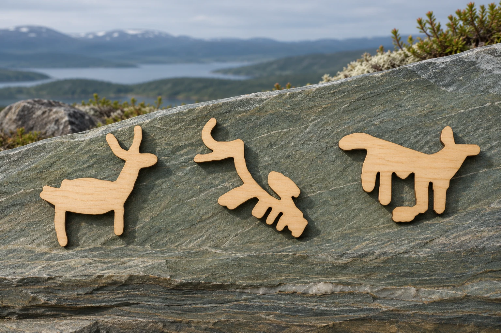
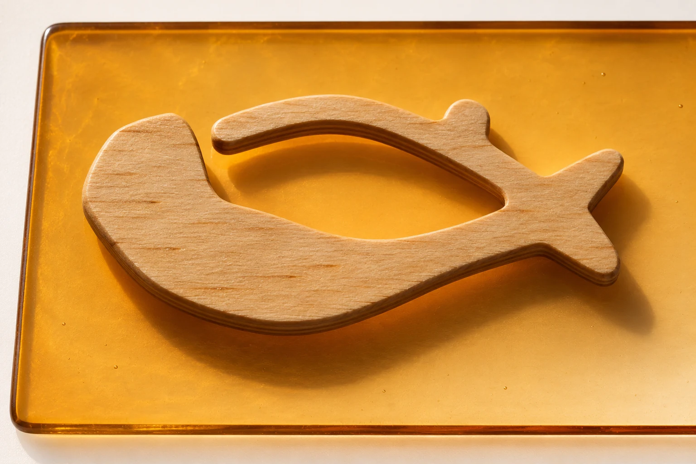
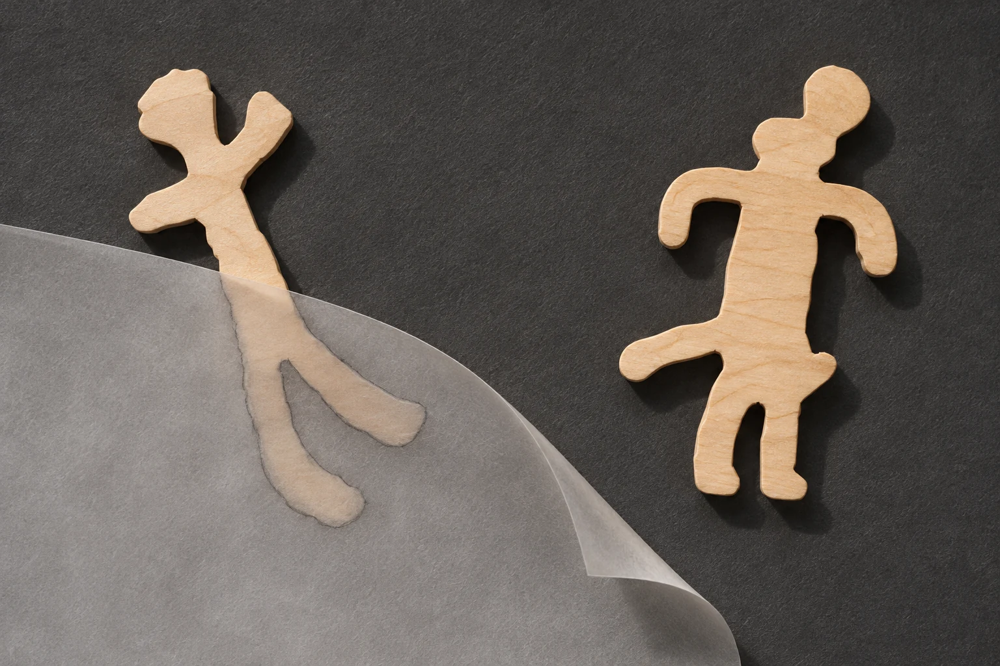
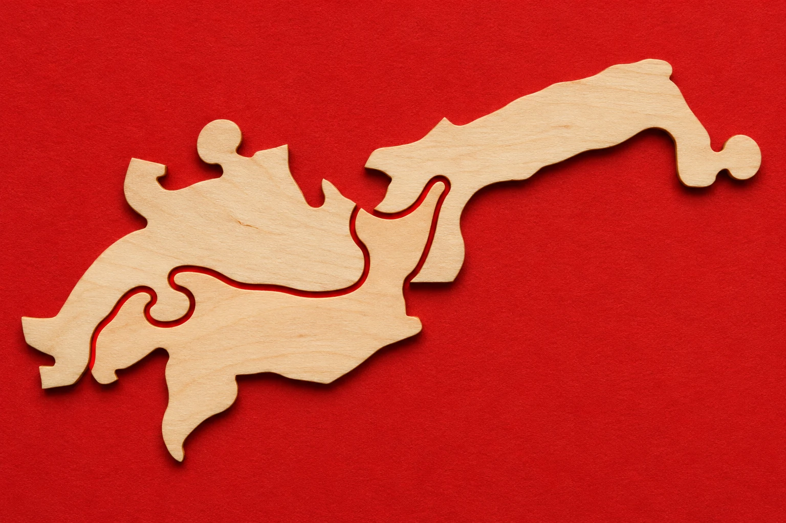
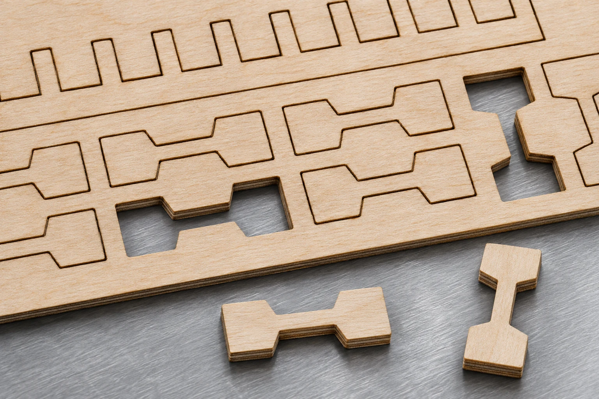
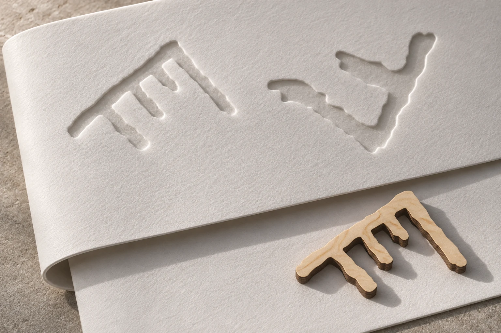
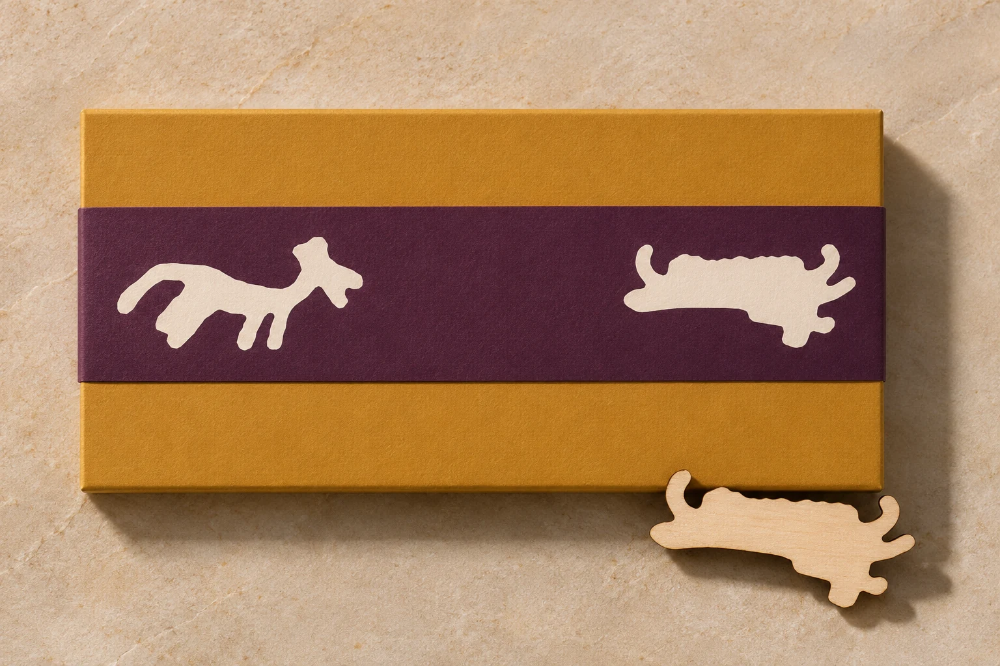
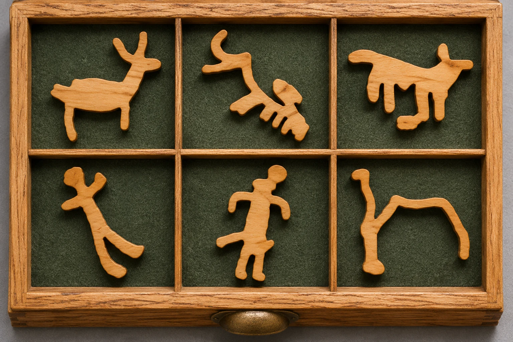
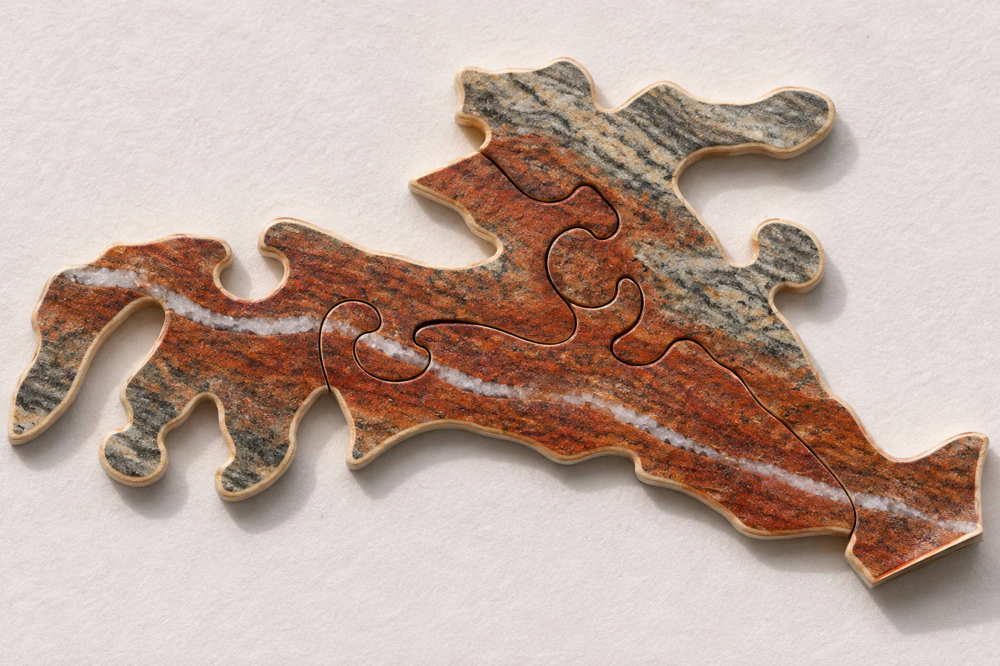
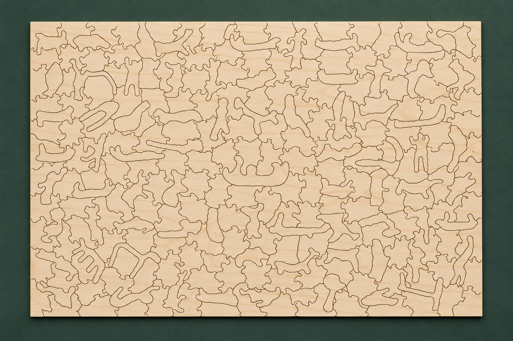

# Helleristningar · Product studies 02

Studies 11–19 explore the 750-piece collector’s edition through archival silhouettes, neighboring cut pieces and a laser calibration coupon. Study 19 proposes a mineral pigment treatment for the wooden faces. Study 20 shows the separate 250-piece v4 edition, using its 600 × 400 mm board export as the reference for a generated material rendering. [Study 01](../01/README.md) · [Edition brief](../../packaging-alignment.md)

| | |
|---|---|
| [Vingen quadrupeds](11-vingen-herd.webp)  | [Kvennavika open fish silhouette](12-open-fish.webp)  |
| [Valla and Flyhov silhouettes](13-valla-flyhov.webp)  | [Three-piece seam alignment](14-seam-in-register.webp)  |
| [Birch calibration coupon](15-cut-calibration.webp)  | [Bakkane paper relief](16-bakkane-paper-relief.webp)  |
| [Österöd and Gerum ships on a sleeve](17-two-ship-sleeve.webp)  | [Specimen drawer](18-collection-drawer.webp)  |
| [Mineral pigment across a seam](19-pigment-across-the-seam.webp)  | [Helleristning 250 v4 · board rendering](20-250-board.webp)  |

## Shape sources

The studies use outlines from the Nordic rock-art atlas. Archival tracings and photographs were converted into silhouettes, then interpreted as wooden cut edges, impressions or printed motifs for these renderings. [Figma shape atlas, node 27:338](https://www.figma.com/design/w0sThYnGJQo1cPrYx7GQR8/?node-id=27-338) · [750-piece catalog](../../selected-750-catalog.json) · [Edition rights inventory](../../rights-inventory.csv)

Two local seam references come from the edition’s archived partition. Sample 04 groups pieces 370, 149 and 240. Sample 02 groups pieces 68, 230 and 717. [Seam sample archive](https://drive.google.com/drive/folders/17pcNYGjRkkI39AvoW2rosapMzSANXggJ)

The cut-test study draws on the 750-piece edition’s calibration coupon. Study 20 draws on the board artwork in the separate Helleristning 250 v4 archive. [750-piece calibration worksheet](../../calibration-measurement-worksheet.md) · [250 v4 board export](https://drive.google.com/file/d/1ZRpjcJ8i51cIzvcs_TYbShxlra1pT2FV/view)

| Atlas ID | Edition piece | Archival work | Creator and archive | Source terms |
|---|---:|---|---|---|
| 00070 | 4 | [Valla Östergård Tossene / Tossene 19:2 — Tracing (Plastic) (1999)](https://shfa.dh.gu.se/image/110660) | Broström, Sven-Gunnar och Ihrestam, Kenneth / Stiftelsen för dokumentation av Bohusläns hällristningar · SHFA, University of Gothenburg | [CC BY 4.0](https://creativecommons.org/licenses/by/4.0/) |
| 00122 | 146 | [Gjessing kvennavika 1936](https://commons.wikimedia.org/wiki/File:Gjessing_kvennavika_1936.jpg) | Gutorm Gjessing (field tracing), Mary Wilhelmsen (final drawing) · Wikimedia Commons | [Public domain](https://creativecommons.org/publicdomain/mark/1.0/) |
| 00155 | 190 | [Bakkane 11:5 / Bakkane 11:5 (Vingen Bakkane 5) / Askeladden 145557-5 — Tracing (Plastic) (1976)](https://shfa.dh.gu.se/image/134390) | Bakka, Egil / Universitetet i Bergen · SHFA, University of Gothenburg | [CC BY 4.0](https://creativecommons.org/licenses/by/4.0/) |
| 00156 | 192 | [Bakkane 11:5 / Bakkane 11:5 (Vingen Bakkane 5) / Askeladden 145557-5 — Tracing (Plastic) (1976)](https://shfa.dh.gu.se/image/134390) | Bakka, Egil / Universitetet i Bergen · SHFA, University of Gothenburg | [CC BY 4.0](https://creativecommons.org/licenses/by/4.0/) |
| 00254 | 692 | [Foto etter kalkering. (Vingen, Bremanger)](https://www.unimus.no/portal/#/photos/3e6ac10d-908a-4d31-9898-2bae481c0121) | Universitetsmuseet i Bergen · Unimus | [CC BY-SA 4.0](https://creativecommons.org/licenses/by-sa/4.0/) |
| 00270 | 677 | [Foto etter kalkering. (Vingen, Bremanger)](https://www.unimus.no/portal/#/photos/f68e949b-fb8d-4ab0-b474-3dd1678de352) | Universitetsmuseet i Bergen · Unimus | [CC BY-SA 4.0](https://creativecommons.org/licenses/by-sa/4.0/) |
| 00311 | 717 | [Foto etter kalkering. (Vingen, Bremanger)](https://www.unimus.no/portal/#/photos/deea5aa8-b919-4fd0-bd9e-c28bbe821ea4) | Universitetsmuseet i Bergen · Unimus | [CC BY-SA 4.0](https://creativecommons.org/licenses/by-sa/4.0/) |
| 00347 | 668 | [Foto etter kalkering. (Vingen, Bremanger)](https://www.unimus.no/portal/#/photos/337d3c51-609f-4309-93f5-d95f976b5a62) | Universitetsmuseet i Bergen · Unimus | [CC BY-SA 4.0](https://creativecommons.org/licenses/by-sa/4.0/) |
| 00450 | 479 | [Bølareinen kontekst](https://commons.wikimedia.org/wiki/File:B%C3%B8lareinen_kontekst.png) | Ranveig · Wikimedia Commons | [Public domain](https://creativecommons.org/publicdomain/mark/1.0/) |
| 01137 | 370 | [Lökeberg Foss / Foss 6:1 — Tracing (Plastic) (2011)](https://shfa.dh.gu.se/image/110673) | Andersson, Tommy och Toreld, Andreas / Stiftelsen för dokumentation av Bohusläns hällristningar · SHFA, University of Gothenburg | [CC BY 4.0](https://creativecommons.org/licenses/by/4.0/) |
| 01144 | 113 | [Flyhov Husaby / Husaby 70:1 — Tracing (Plastic) (2004)](https://shfa.dh.gu.se/image/112817) | Andersson, Tommy och Toreld, Andreas / Stiftelsen för dokumentation av Bohusläns hällristningar · SHFA, University of Gothenburg | [CC BY 4.0](https://creativecommons.org/licenses/by/4.0/) |
| 01221 | 68 | [Aspeberget Tanum / Tanum 17:1 — Graphic (1993)](https://shfa.dh.gu.se/image/110110) | Tanums Hällristningsmuseum / Tanums Hällristningsmuseum Underslös · SHFA, University of Gothenburg | [CC BY 4.0](https://creativecommons.org/licenses/by/4.0/) |
| 01495 | 117 | [Österöd Kville / Kville 12:1 — Drawing (1951)](https://shfa.dh.gu.se/image/110094) | Fredsjö, Åke / Vitlycke museum · SHFA, University of Gothenburg | [CC BY 4.0](https://creativecommons.org/licenses/by/4.0/) |
| 01557 | 44 | [Gerum Runohällen Tanum / Tanum 311:1 — Graphic](https://shfa.dh.gu.se/image/112889) | Tanums Hällristningsmuseum / Tanums Hällristningsmuseum Underslös · SHFA, University of Gothenburg | [CC BY 4.0](https://creativecommons.org/licenses/by/4.0/) |
| 01591 | 230 | [Borg Norrköping / Borg 17:1 — Tracing (Plastic) (1992)](https://shfa.dh.gu.se/image/115535) | Broström, Sven-Gunnar och Ihrestam, Kenneth / SHFA · SHFA, University of Gothenburg | [CC BY 4.0](https://creativecommons.org/licenses/by/4.0/) |
| 01615 | 149 | [Tossene / Tossene 58:5 — Tracing (Plastic) (1999)](https://shfa.dh.gu.se/image/127422) | Broström, Sven-Gunnar och Ihrestam, Kenneth / Stiftelsen för dokumentation av Bohusläns hällristningar · SHFA, University of Gothenburg | [CC BY 4.0](https://creativecommons.org/licenses/by/4.0/) |
| 01628 | 240 | [Björkemyr Backa Brastad / Brastad 63:1 — Tracing (Plastic) (2009)](https://shfa.dh.gu.se/image/128609) | Andersson, Tommy och Toreld, Andreas / Stiftelsen för dokumentation av Bohusläns hällristningar · SHFA, University of Gothenburg | [CC BY 4.0](https://creativecommons.org/licenses/by/4.0/) |

Adapted motifs from the Unimus works credited under CC BY-SA 4.0 are also shared under [CC BY-SA 4.0](https://creativecommons.org/licenses/by-sa/4.0/).
