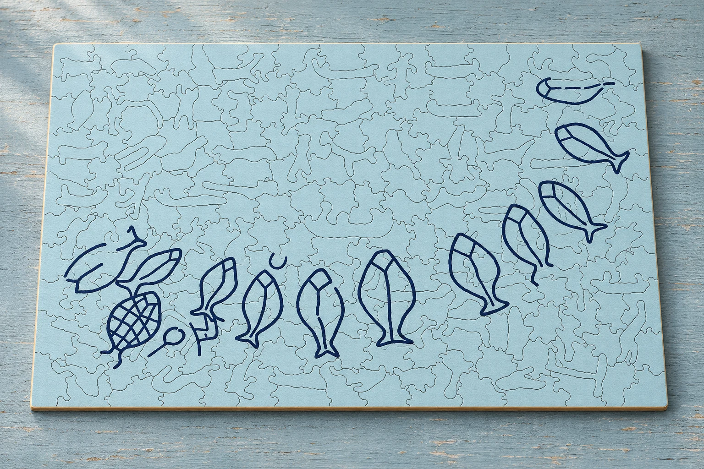
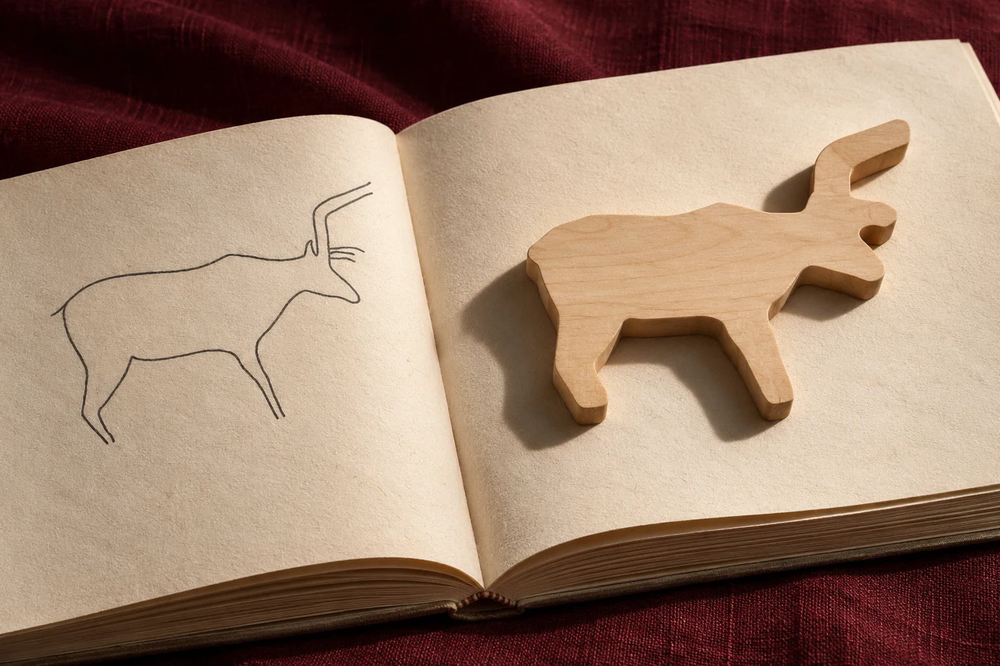
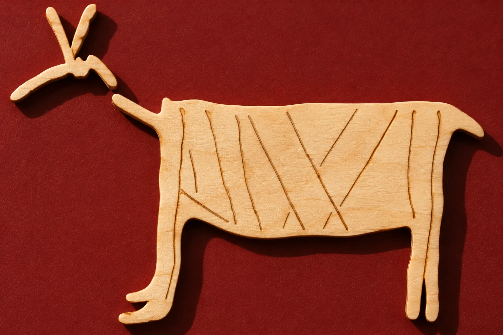
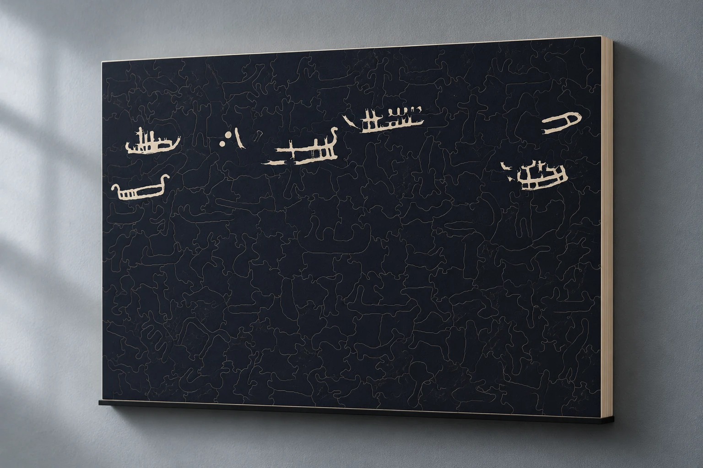
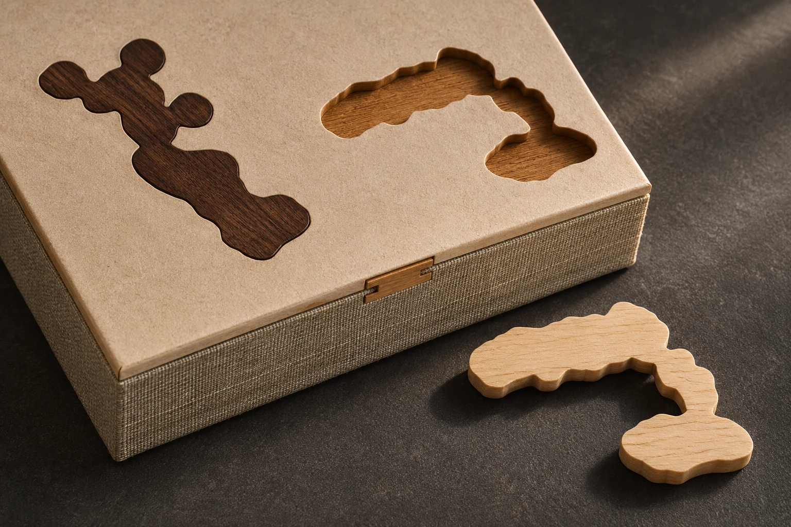
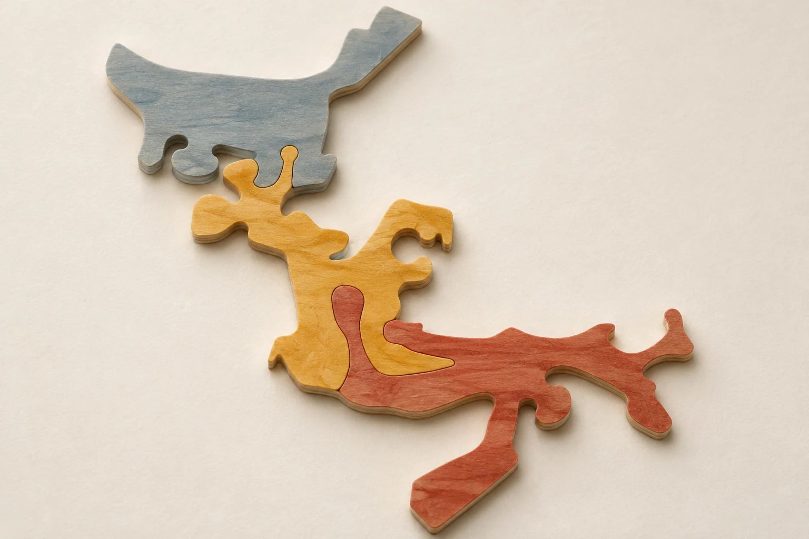
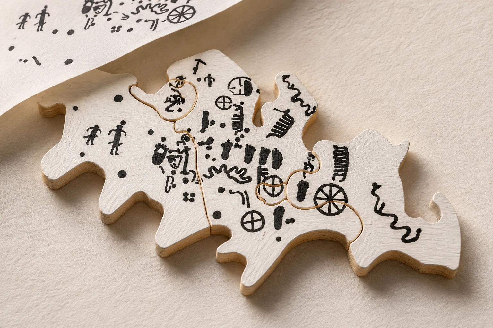
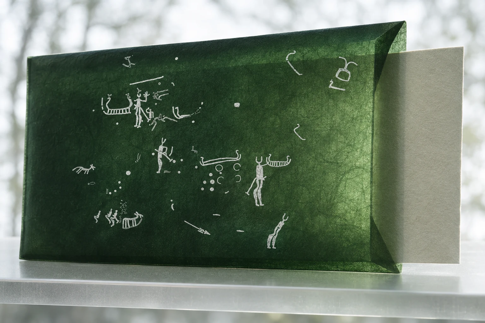
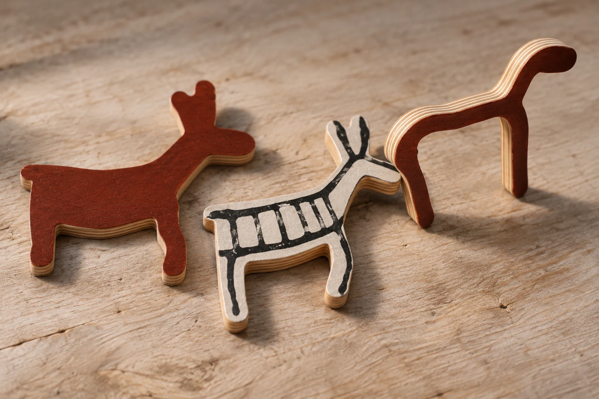
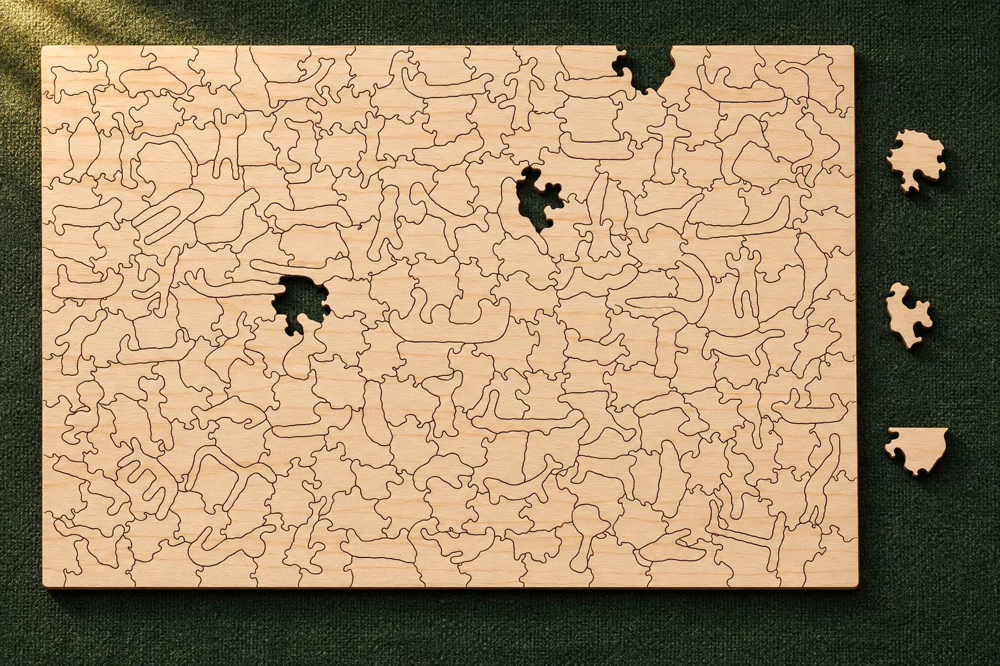

# Helleristningar · Product studies 03

Ten generated images explore how archival rock-art drawings could appear in ink, shallow engraving, wood inlay and reversible finishes. [Studies 01](../01/README.md) · [Studies 02](../02/README.md)

| | |
|---|---|
| [21 · Kvennavika fish in Prussian blue](21-kvennavika-shoal.webp)  | [22 · The Bøla drawing and cut silhouette](22-lossius-book-and-piece.webp)  |
| [23 · Bak Vehammaren scored in birch](23-bak-scored-ribs.webp)  | [24 · Evje ships on a dark face](24-evje-night-crossing.webp)  |
| [25 · Footprints inlaid in the box lid](25-footprint-inlay.webp)  | [26 · Three tones at a shared seam](26-three-tone-seam.webp)  |
| [27 · Flyhov print across a piece cluster](27-flyhov-print-face.webp)  | [28 · Österöd on a translucent sleeve](28-osterod-contact-negative.webp)  |
| [29 · Vingen on front and reverse](29-vingen-reversible.webp)  | [30 · Three pieces pulled from the 250 v4 board](30-last-three.webp)  |

## Board and seam references

Studies 21 and 24 place proposed Kvennavika and Evje prints over the cut network of the rectangular Helleristning 250 v4 board (600 × 400 mm). The reference for study 30 uses the same exported cut with pieces 206, 210 and 242 removed. The images interpret these references as physical objects. [250 v4 board and cut files](https://drive.google.com/drive/folders/1wjVhF8QGvCP3h5eNmrxKXjLGzeihDdPS)

Studies 26 and 27 draw on two local assemblies from the 750-piece edition. Sample 03 groups pieces 392, 669 and 693. Sample 05 groups pieces 688, 259 and 196. The Flyhov tracing supplies the proposed surface print in study 27. [750-piece seam samples](https://drive.google.com/drive/folders/17pcNYGjRkkI39AvoW2rosapMzSANXggJ) · [750-piece edition brief](../../packaging-alignment.md)

## Archival sources

The studies adapt silhouettes and details of archived tracings and photographs by isolating motifs, changing scale or colour, and translating lines into print, engraved marks or cut edges. The table credits the seven original plates used directly in this set, the shape and seam sources, and the Bakkane plate from the earlier studies. Atlas IDs identify the underlying records. [Figma motif atlas](https://www.figma.com/design/w0sThYnGJQo1cPrYx7GQR8/?node-id=27-338) · [750-piece source catalog](../../selected-750-catalog.json) · [Rights inventory](../../rights-inventory.csv)

| Study | Atlas IDs | Source work | Creator and archive | Source terms |
|---|---|---|---|---|
| 21 | 00002, 00122 | [Gjessing kvennavika 1936](https://commons.wikimedia.org/wiki/File:Gjessing_kvennavika_1936.jpg) | Gutorm Gjessing (field tracing), Mary Wilhelmsen (final drawing) · Wikimedia Commons | [Public domain](https://creativecommons.org/publicdomain/mark/1.0/) |
| 22 | 00449 | [Bølareinen Lossius 1898](https://commons.wikimedia.org/wiki/File:B%C3%B8lareinen_Lossius_1898.png) | Knut Henrik Lossius · Wikimedia Commons | [Public domain](https://creativecommons.org/publicdomain/mark/1.0/) |
| 23 | 00004, 00137 | [Bak Vehammaren 2:5d / Askeladden 117465-5 — Tracing (Plastic) (1938)](https://shfa.dh.gu.se/image/134296) | Hallström, Gustaf / Universitetet i Bergen · SHFA, University of Gothenburg | [CC BY 4.0](https://creativecommons.org/licenses/by/4.0/) |
| 24 | 00043, 00736, 00924 | [Kalkering av helleristninger: skipsfigurer (Evje, Fredrikstad)](https://www.unimus.no/portal/#/photos/8054f0e2-7a20-4bf3-9dd2-cb0733da649a) | Vogt, David / Kulturhistorisk museum, UiO · Unimus | [CC BY-SA 4.0](https://creativecommons.org/licenses/by-sa/4.0/) |
| 25 | 01473 | [Översta Björksta / Björksta 225:3 — Graphic (2004)](https://shfa.dh.gu.se/image/109974) | Broström, Sven-Gunnar / Botark · SHFA, University of Gothenburg | [CC BY 4.0](https://creativecommons.org/licenses/by/4.0/) |
| 25 | 01476 | [Halahult - KMB - 16001000512826](https://commons.wikimedia.org/wiki/File:Halahult_-_KMB_-_16001000512826.jpg) | Lars Kennerstedt · Wikimedia Commons | [Public domain](https://creativecommons.org/publicdomain/mark/1.0/) |
| 26 | 01249 | [Kalleby Långemyr Tanum / Tanum 405:1 — Graphic (1993)](https://shfa.dh.gu.se/image/110133) | Tanums Hällristningsmuseum / Tanums Hällristningsmuseum Underslös · SHFA, University of Gothenburg | [CC BY 4.0](https://creativecommons.org/licenses/by/4.0/) |
| 26 | 00289 | [Foto etter kalkering. (Vingen, Bremanger)](https://www.unimus.no/portal/#/photos/78dd8f67-4956-49e7-afa1-ab9ef9b8c374) | Universitetsmuseet i Bergen · Unimus | [CC BY-SA 4.0](https://creativecommons.org/licenses/by-sa/4.0/) |
| 26 | 00201 | [Foto etter kalkering. (Vingen, Bremanger)](https://www.unimus.no/portal/#/photos/897a7beb-94ad-46d1-aacf-58182cba118e) | Universitetsmuseet i Bergen · Unimus | [CC BY-SA 4.0](https://creativecommons.org/licenses/by-sa/4.0/) |
| 27 | 00085, 01143, 01144, 01146, 01147 | [Flyhov Husaby / Husaby 70:1 — Tracing (Plastic) (2004)](https://shfa.dh.gu.se/image/112817) | Andersson, Tommy och Toreld, Andreas / Stiftelsen för dokumentation av Bohusläns hällristningar · SHFA, University of Gothenburg | [CC BY 4.0](https://creativecommons.org/licenses/by/4.0/) |
| 27 | 00369 | [Foto etter kalkering. (Vingen, Bremanger)](https://www.unimus.no/portal/#/photos/ab0a82d9-82d8-4382-b0ad-7f2f0cf0a5e8) | Universitetsmuseet i Bergen · Unimus | [CC BY-SA 4.0](https://creativecommons.org/licenses/by-sa/4.0/) |
| 27 | 01070 | [Borg Skälv Norrköping / Borg 27:1 — Tracing (Plastic) (1992)](https://shfa.dh.gu.se/image/115537) | Broström, Sven-Gunnar och Ihrestam, Kenneth / SHFA · SHFA, University of Gothenburg | [CC BY 4.0](https://creativecommons.org/licenses/by/4.0/) |
| 27 | 01222 | [Aspeberget Tanum / Tanum 17:1 — Graphic (1993)](https://shfa.dh.gu.se/image/110110) | Tanums Hällristningsmuseum / Tanums Hällristningsmuseum Underslös · SHFA, University of Gothenburg | [CC BY 4.0](https://creativecommons.org/licenses/by/4.0/) |
| 28 | 01048, 01110, 01494, 01495 | [Österöd Kville / Kville 12:1 — Drawing (1951)](https://shfa.dh.gu.se/image/110094) | Fredsjö, Åke / Vitlycke museum · SHFA, University of Gothenburg | [CC BY 4.0](https://creativecommons.org/licenses/by/4.0/) |
| 29 | 00344, 00345, 00348 | [Foto etter kalkering. (Vingen, Bremanger)](https://www.unimus.no/portal/#/photos/337d3c51-609f-4309-93f5-d95f976b5a62) | Universitetsmuseet i Bergen · Unimus | [CC BY-SA 4.0](https://creativecommons.org/licenses/by-sa/4.0/) |
| Earlier Bakkane studies | 00155, 00156, 00154 | [Bakkane 11:5 / Bakkane 11:5 (Vingen Bakkane 5) / Askeladden 145557-5 — Tracing (Plastic) (1976)](https://shfa.dh.gu.se/image/134390) | Bakka, Egil / Universitetet i Bergen · SHFA, University of Gothenburg | [CC BY 4.0](https://creativecommons.org/licenses/by/4.0/) |

Adapted motifs and imagery from the Unimus works credited under CC BY-SA 4.0 are also shared under [CC BY-SA 4.0](https://creativecommons.org/licenses/by-sa/4.0/).
