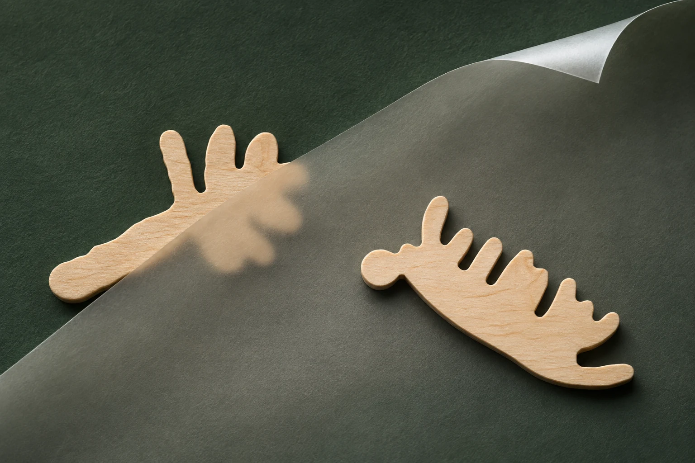
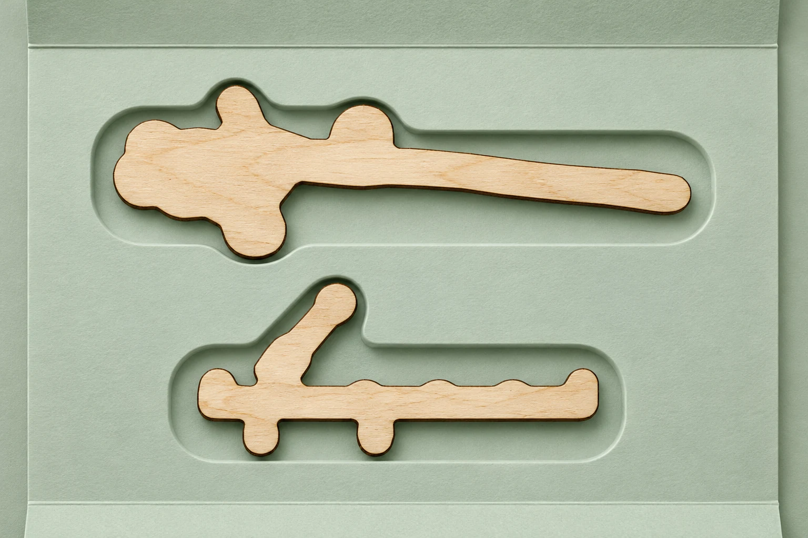
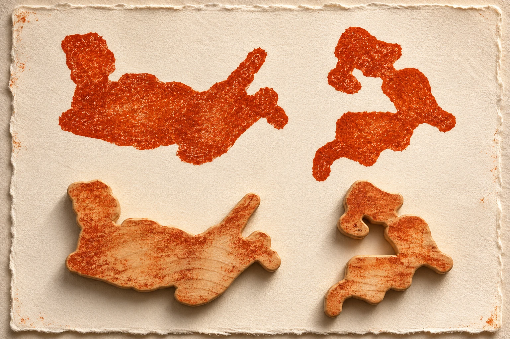
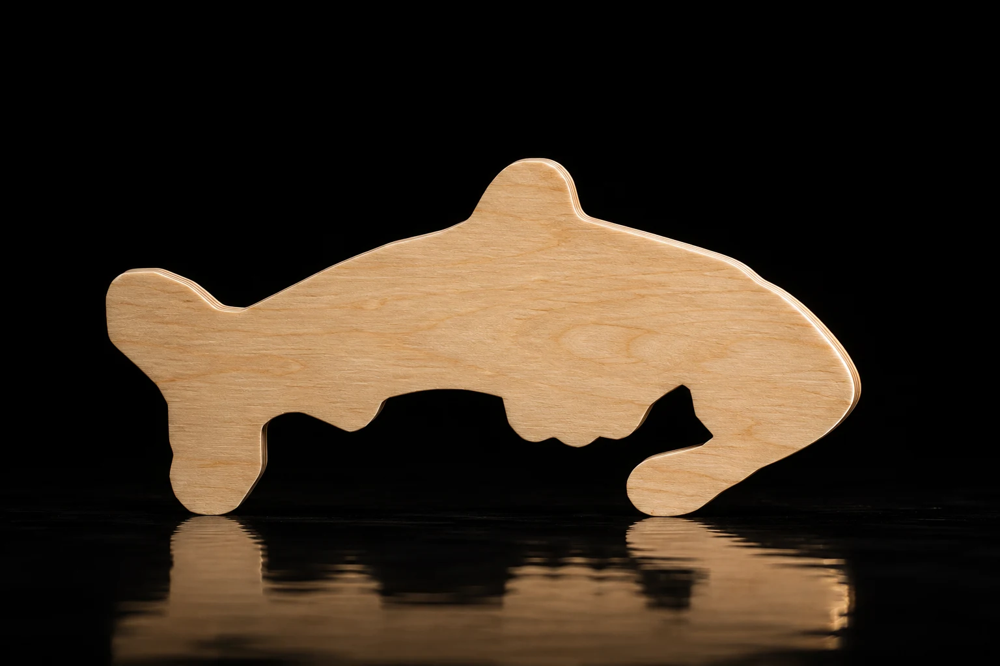
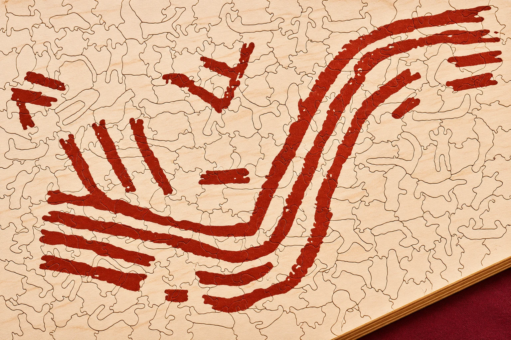
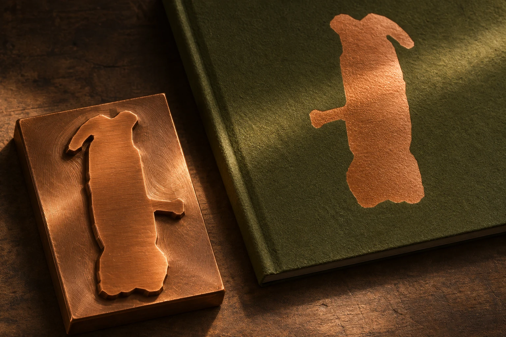
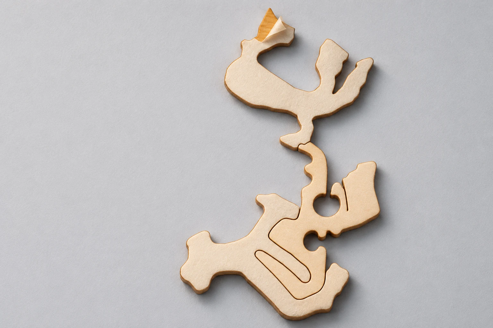
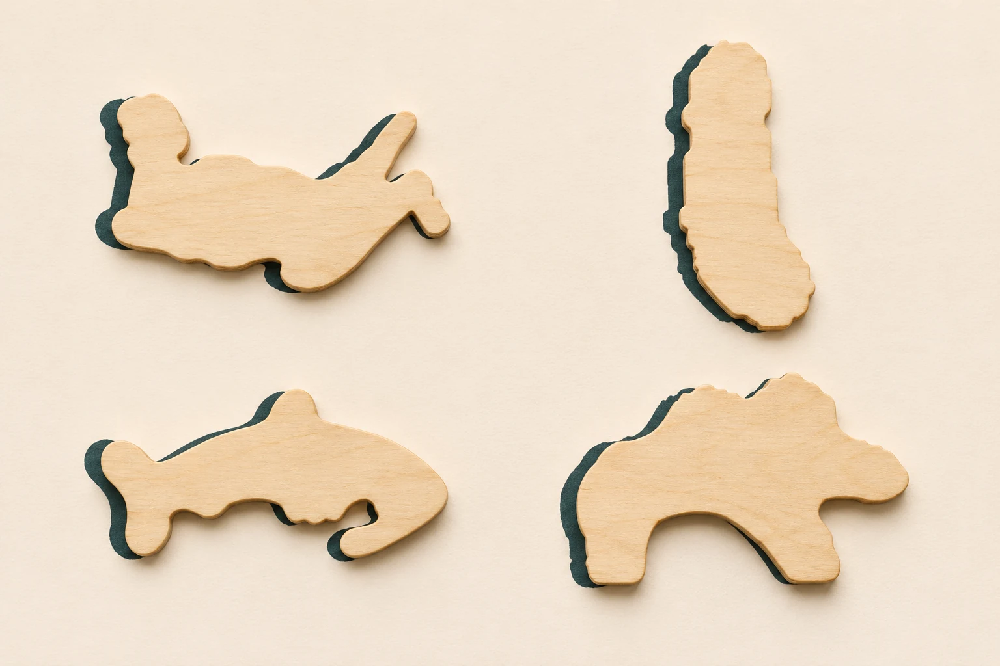
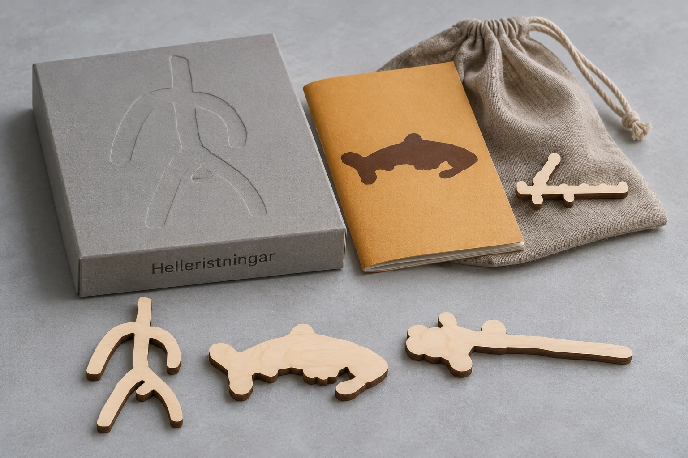

# Helleristningar · Product studies 04

Ten generated product images explore how each carving reads in a wooden piece, on a printed surface or as a blind impression. The final study brings together the collector’s box, A5 guide, pouch and four loose silhouettes. [Studies 01](../01/README.md) · [Studies 02](../02/README.md) · [Studies 03](../03/README.md)

| | |
|---|---|
| [31 · Teigen in balance](31-teigen-in-balance.webp)  | [32 · Tossene under tracing paper](32-tossene-under-vellum.webp)  |
| [33 · Two hulls from Tossene](33-tossene-two-hulls.webp)  | [34 · A Bogge relief-print proof](34-bogge-printers-proof.webp)  |
| [35 · Evenhus on black glaze](35-evenhus-black-glaze.webp)  | [36 · Bakkane in iron red](36-bakkane-iron-red.webp)  |
| [37 · Vitlycke bookbinding die](37-vitlycke-bookbinders-die.webp)  | [38 · Three pieces and a paper mask](38-seam-and-mask.webp)  |
| [39 · Four contour proofs from the 250-piece board](39-four-contour-proofs.webp)  | [40 · Helleristningar collector’s set](40-helleristningar-collector-set.webp)  |

## Board and seam references

Study 36 places an enlarged iron-red detail from Egil Bakka’s 1976 Bakkane tracing on the cut geometry of the rectangular 600 × 400 mm Helleristning 250 v4 edition. Study 39 uses the edition’s four-contour comparison sheet. Its labeled piece numbers are 3 (Bogge), 11 (Rickeby), 9 (Evenhus) and 32 (Himmelstalund). [250 v4 cut files and comparison sheet](https://drive.google.com/drive/folders/1wjVhF8QGvCP3h5eNmrxKXjLGzeihDdPS)

Study 38 uses three neighbouring pieces from the 750-piece edition. Their shared edges come from partition sample 01, pieces 181, 414 and 714. [750-piece seam samples](https://drive.google.com/drive/folders/17pcNYGjRkkI39AvoW2rosapMzSANXggJ) · [Collector’s edition and packaging brief](../../packaging-alignment.md)

## Archival sources

The studies adapt archived imagery by isolating motifs, adjusting scale and colour, and interpreting shapes as birch silhouettes, rubbings, relief prints, embossing dies or printed board faces. Catalog IDs trace the motifs to the two editions’ source records. [Figma motif atlas](https://www.figma.com/design/w0sThYnGJQo1cPrYx7GQR8/?node-id=27-338) · [750-piece catalog](../../selected-750-catalog.json) · [250-piece motif register](https://drive.google.com/file/d/1Dh5cLzo4Hy5VQeInpIlUDxjguIaTN5NQ/view)

| Study | Atlas IDs | Source work | Creator and archive | Source terms |
|---|---|---|---|---|
| 31, 40 | 00539 | [Teigen 7:1b / Askeladden 145528-1 — Tracing (Plastic) (1932)](https://shfa.dh.gu.se/image/134340) | Bøe, Johannes / Universitetet i Bergen · SHFA, University of Gothenburg | [CC BY 4.0](https://creativecommons.org/licenses/by/4.0/) |
| 32 | 01420 | [Överby Tossene / Tossene 432:1 — Tracing (Plastic) (2003)](https://shfa.dh.gu.se/image/127609) | Andersson, Tommy och Toreld, Andreas / Stiftelsen för dokumentation av Bohusläns hällristningar · SHFA, University of Gothenburg | [CC BY 4.0](https://creativecommons.org/licenses/by/4.0/) |
| 32 | 01270 | [Torp Tossene / Tossene 13:1 — Tracing (Plastic) (1999)](https://shfa.dh.gu.se/image/110649) | Broström, Sven-Gunnar och Ihrestam, Kenneth / Stiftelsen för dokumentation av Bohusläns hällristningar · SHFA, University of Gothenburg | [CC BY 4.0](https://creativecommons.org/licenses/by/4.0/) |
| 33, 38, 40 | 01613, 01614, 01615 | [Tossene / Tossene 58:5 — Tracing (Plastic) (1999)](https://shfa.dh.gu.se/image/127422) | Broström, Sven-Gunnar och Ihrestam, Kenneth / Stiftelsen för dokumentation av Bohusläns hällristningar · SHFA, University of Gothenburg | [CC BY 4.0](https://creativecommons.org/licenses/by/4.0/) |
| 34, 39 | 00918, 00919 | [” Saksefigur” kalkert (Bogge , Nesset)](https://www.unimus.no/portal/#/photos/e9dc7668-26bb-4a60-a8bd-22af5c728ab4) | Heidrun Stebergløkken og Eva Lindgaard / NTNU Vitenskapsmuseet · Unimus | [CC BY-SA 4.0](https://creativecommons.org/licenses/by-sa/4.0/) |
| 35, 39, 40 | 01034 | [Bergkunst Evenhus gruppe 6 kalkert Petersen Gjessing](https://commons.wikimedia.org/wiki/File:Bergkunst_Evenhus_gruppe_6_kalkert_Petersen_Gjessing.jpg) | Th. Petersen (field tracing), Gutorm Gjessing (final drawing) · Wikimedia Commons | [Public domain](https://creativecommons.org/publicdomain/mark/1.0/) |
| 36 | 00154, 00155, 00156 | [Bakkane 11:5 / Bakkane 11:5 (Vingen Bakkane 5) / Askeladden 145557-5 — Tracing (Plastic) (1976)](https://shfa.dh.gu.se/image/134390) | Bakka, Egil / Universitetet i Bergen · SHFA, University of Gothenburg | [CC BY 4.0](https://creativecommons.org/licenses/by/4.0/) |
| 37 | 01101 | [Vitlyckehällen - KMB - 16000300015108](https://commons.wikimedia.org/wiki/File:Vitlyckeh%C3%A4llen_-_KMB_-_16000300015108.jpg) | Bengt A. Lundberg · Wikimedia Commons | [CC BY 2.5](https://creativecommons.org/licenses/by/2.5) |
| 38 | 01059 | [Backa Brastad / Brastad 1:1 — Tracing (Plastic) (2004)](https://shfa.dh.gu.se/image/112833) | Andersson, Tommy, Toreld, Andreas, och Bengtsson, Lasse / Stiftelsen för dokumentation av Bohusläns hällristningar · SHFA, University of Gothenburg | [CC BY 4.0](https://creativecommons.org/licenses/by/4.0/) |
| 38 | 00227 | [Foto etter kalkering. (Vingen, Bremanger)](https://www.unimus.no/portal/#/photos/ffda4144-e731-4b66-9e99-00ecf6f1e531) | Universitetsmuseet i Bergen · Unimus | [CC BY-SA 4.0](https://creativecommons.org/licenses/by-sa/4.0/) |
| 39 | 00103 | [Rickeby Boglösa / Boglösa 138:1](https://shfa.dh.gu.se/image/110022) | Broström, Sven-Gunnar och Ihrestam, Kenneth / Botark · SHFA, University of Gothenburg | [CC BY 4.0](https://creativecommons.org/licenses/by/4.0/) |
| 39 | 00065 | [Hällristning – Svinhällen vid Himmelstalund i Norrköping](https://commons.wikimedia.org/wiki/File:H%C3%A4llristning_-_Svinh%C3%A4llen_vid_Himmelstalund_i_Norrk%C3%B6ping..JPG) | Västgöten · Wikimedia Commons | [CC BY-SA 3.0](https://creativecommons.org/licenses/by-sa/3.0/) |

Adaptations of the Unimus and Wikimedia works credited under ShareAlike terms are shared under their respective source licences. [CC BY-SA 4.0](https://creativecommons.org/licenses/by-sa/4.0/) · [CC BY-SA 3.0](https://creativecommons.org/licenses/by-sa/3.0/).
