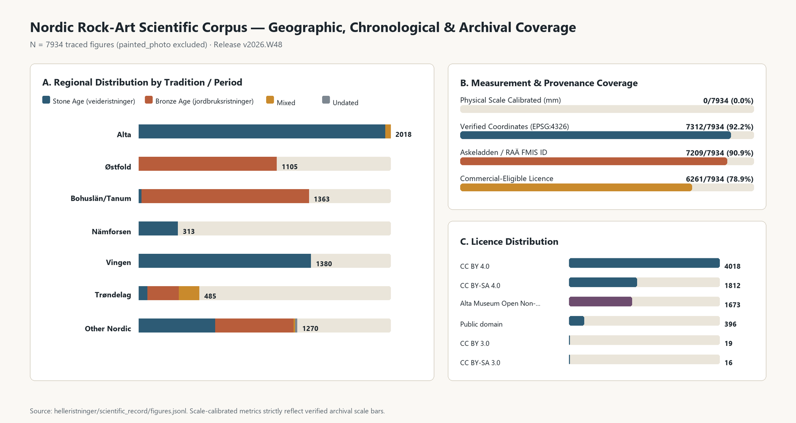
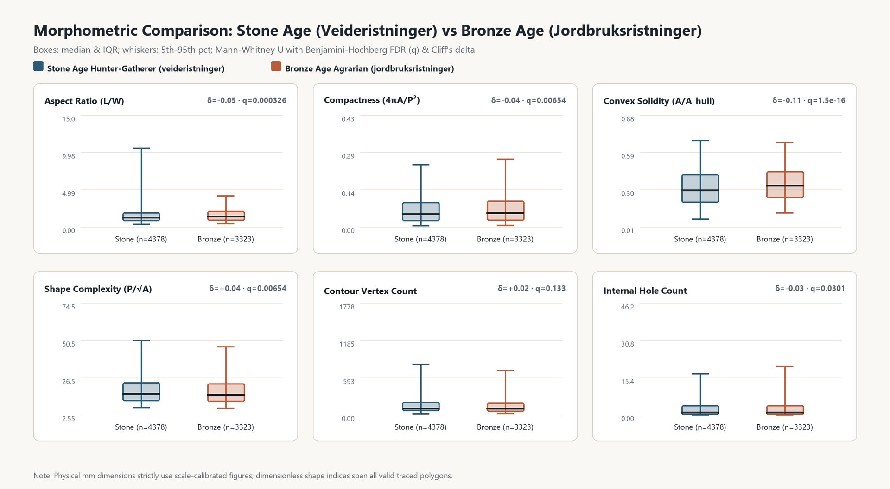
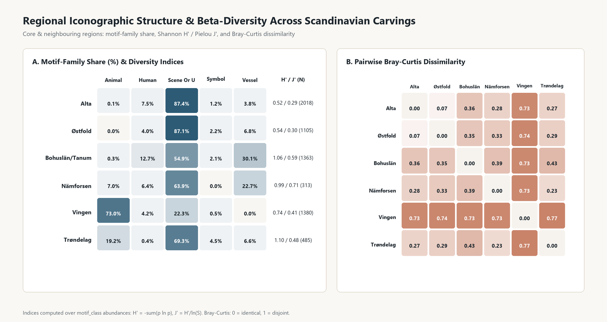
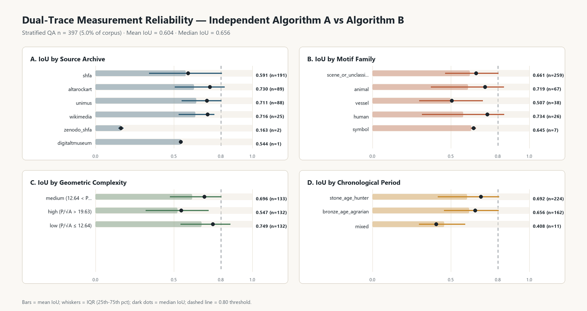

# Nordic Helleristninger Corpus — Scientific Findings Report (v2026.W48)

**Generated:** 2026-11-28T11:08:42Z  
**Corpus Release:** `v2026.W48` (`N = 7934` verified carved figures; `painted_photo` strictly excluded)  
**Random Seed:** `42` (`n_boot = 2000`) · **Environment:** Python `3.11.9`, SciPy `1.17.0`, NumPy `1.26.4`

---

## 1. Corpus Overview & Archival Coverage

| Metric | Value | Notes |
|---|---:|---|
| Total traced figures | **7934** | Carved documentation only (`bw_tracing`, `svg_vector`, `rubbing_frottage`, `rti_3d`) |
| Scale-calibrated figures (mm) | **0** (0.0%) | Verified physical scale bar (`scale_calibrated: true`) |
| Uncalibrated figures (px space) | **7934** (100.0%) | Flagged `scale_calibrated: false`; no fabricated mm scale |
| Verified EPSG:4326 coordinates | **7312** (92.2%) | Site/panel-level geospatial linkage |
| Verified Askeladden / RAÄ FMIS ID | **7209** (90.9%) | Heritage register linkage |
| Commercial-eligible records | **6261** (78.9%) | Scientific corpus retains NC-SA (`CC BY-NC-SA`) for scholarship; puzzle excludes NC-SA |

### Regional & Chronological Distribution

| Region | Total | Stone Age (`veideristninger`) | Bronze Age (`jordbruksristninger`) | Mixed | Unknown |
|---|---:|---:|---:|---:|---:|
| Alta | **2018** | 1977 | 0 | 41 | 0 |
| Østfold | **1105** | 0 | 1105 | 0 | 0 |
| Bohuslän/Tanum | **1363** | 23 | 1340 | 0 | 0 |
| Nämforsen | **313** | 313 | 0 | 0 | 0 |
| Vingen | **1380** | 1380 | 0 | 0 | 0 |
| Trøndelag | **485** | 72 | 250 | 163 | 0 |
| Other Nordic | **1270** | 613 | 628 | 13 | 16 |



---

## 2. Morphometric Comparison: Stone Age (*Veideristninger*) vs. Bronze Age (*Jordbruksristninger*)

Non-parametric two-sided Mann-Whitney *U* tests compare Stone Age hunter-gatherer carvings (`stone_age_hunter`) against Bronze Age agrarian carvings (`bronze_age_agrarian`). Effect sizes report both rank-biserial correlation ($r_{rb} = 2U/(n_1 n_2) - 1$) and exact Cliff's $\delta$ ($P(X_{\text{stone}} > X_{\text{bronze}}) - P(X_{\text{stone}} < X_{\text{bronze}})$) with 2000-replicate percentile 95% bootstrap confidence intervals (seed `42`). Multiplicity is controlled via Benjamini-Hochberg False Discovery Rate ($q$-value).

| Metric | Calibrated Only? | Stone Age $n$ / Median [IQR] | Bronze Age $n$ / Median [IQR] | Mann-Whitney $U$ | $p$-value | BH $q$-value | Cliff's $\delta$ [95% CI] | Magnitude | Med. Diff [95% CI] |
|---|---|---:|---:|---:|---:|---:|---|---|---|
| Calibrated Area (mm²) | Yes | 0 / n/a | 0 / n/a | n/a | n/a | n/a | n/a | insufficient n | n/a |
| Calibrated Width (mm) | Yes | 0 / n/a | 0 / n/a | n/a | n/a | n/a | n/a | insufficient n | n/a |
| Calibrated Height (mm) | Yes | 0 / n/a | 0 / n/a | n/a | n/a | n/a | n/a | insufficient n | n/a |
| Calibrated Perimeter (mm) | Yes | 0 / n/a | 0 / n/a | n/a | n/a | n/a | n/a | insufficient n | n/a |
| Aspect Ratio (L/W) | No | 4378 / 1.23 [0.79, 1.96] | 3323 / 1.35 [0.85, 2.15] | 6906014 | 0.0001 | **0.0003** | -0.051 [-0.076, -0.023] | negligible | -0.12 [-0.17, -0.06] |
| Compactness (4πA/P²) | No | 4378 / 0.05 [0.02, 0.10] | 3323 / 0.05 [0.02, 0.10] | 7000640 | 0.0047 | **0.0065** | -0.038 [-0.064, -0.012] | negligible | -0.00 [-0.01, -0.00] |
| Convex Solidity (A/A_hull) | No | 4378 / 0.29 [0.20, 0.42] | 3323 / 0.33 [0.23, 0.44] | 6454072 | 2.14e-17 | **1.50e-16** | -0.113 [-0.139, -0.087] | negligible | -0.04 [-0.04, -0.03] |
| Shape Complexity (P/√A) | No | 4378 / 16.04 [11.45, 23.63] | 3323 / 15.40 [11.12, 22.78] | 7547423 | 0.0047 | **0.0065** | +0.038 [+0.012, +0.063] | negligible | +0.65 [+0.19, +1.13] |
| Contour Vertex Count | No | 4378 / 98.00 [58.00, 207.00] | 3323 / 98.00 [52.00, 192.00] | 7419205 | 0.1330 | **0.1330** | +0.020 [-0.006, +0.047] | negligible | +0.00 [-4.00, +5.00] |
| Internal Hole Count | No | 4378 / 1.00 [0.00, 4.00] | 3323 / 1.00 [0.00, 4.00] | 7067298 | 0.0258 | **0.0301** | -0.028 [-0.053, -0.003] | negligible | +0.00 [+0.00, +0.00] |
| Associated Cup Marks | No | 4378 / 0.00 [0.00, 2.00] | 3323 / 1.00 [0.00, 3.00] | 6900680 | 3.72e-05 | **0.0001** | -0.051 [-0.076, -0.026] | negligible | -1.00 [-1.00, +0.00] |



---

## 3. Regional Iconographic Diversity & Beta-Diversity

### Alpha Diversity Across Regions (Motif Class Level)

| Region | $n$ | Richness ($S$) | Shannon $H'$ (nats) | Effective Classes ($e^{H'}$) | Pielou Evenness ($J'$) | Simpson ($1 - D$) | Top Motif Classes |
|---|---:|---:|---:|---:|---:|---:|---|
| Alta | 2018 | 6 | 0.521 | 1.68 | 0.291 | 0.229 | `unclassified_motif` (1764), `anthropomorph` (152), `bronze_age_ship` (41) |
| Østfold | 1105 | 6 | 0.540 | 1.72 | 0.301 | 0.236 | `unclassified_motif` (962), `bronze_age_ship` (75), `anthropomorph` (35) |
| Bohuslän/Tanum | 1363 | 6 | 1.064 | 2.90 | 0.594 | 0.592 | `unclassified_motif` (748), `bronze_age_ship` (410), `anthropomorph` (173) |
| Nämforsen | 313 | 4 | 0.985 | 2.68 | 0.711 | 0.531 | `unclassified_motif` (200), `stone_age_boat` (71), `elk_moose` (22) |
| Vingen | 1380 | 6 | 0.737 | 2.09 | 0.411 | 0.418 | `quadruped_other` (1005), `unclassified_motif` (308), `anthropomorph` (58) |
| Trøndelag | 485 | 10 | 1.096 | 2.99 | 0.476 | 0.492 | `unclassified_motif` (336), `elk_moose` (72), `stone_age_boat` (29) |

**Region × Motif Family Contingency Test:** $\chi^2(20) = 4990.87$, $p = 0.00e+00$, Cramér's $V = 0.433$ *(note: sparse cells with expected count < 5)*.

### Pairwise Jaccard Distance Matrix ($1 - J$, Presence-Absence)

| Region | Alta | Østfold | Bohuslän/Tanum | Nämforsen | Vingen | Trøndelag |
|---|---:|---:|---:|---:|---:|---:|
| Alta | 0.000 | 0.500 | 0.667 | 0.571 | 0.667 | 0.400 |
| Østfold | 0.500 | 0.000 | 0.667 | 0.750 | 0.667 | 0.667 |
| Bohuslän/Tanum | 0.667 | 0.667 | 0.000 | 0.750 | 0.500 | 0.667 |
| Nämforsen | 0.571 | 0.750 | 0.750 | 0.000 | 0.750 | 0.600 |
| Vingen | 0.667 | 0.667 | 0.500 | 0.750 | 0.000 | 0.545 |
| Trøndelag | 0.400 | 0.667 | 0.667 | 0.600 | 0.545 | 0.000 |

### Pairwise Bray-Curtis Dissimilarity Matrix (Relative Motif-Class Abundances)

| Region | Alta | Østfold | Bohuslän/Tanum | Nämforsen | Vingen | Trøndelag |
|---|---:|---:|---:|---:|---:|---:|
| Alta | 0.000 | 0.066 | 0.356 | 0.280 | 0.730 | 0.274 |
| Østfold | 0.066 | 0.000 | 0.352 | 0.329 | 0.741 | 0.293 |
| Bohuslän/Tanum | 0.356 | 0.352 | 0.000 | 0.387 | 0.731 | 0.431 |
| Nämforsen | 0.280 | 0.329 | 0.387 | 0.000 | 0.735 | 0.227 |
| Vingen | 0.730 | 0.741 | 0.731 | 0.735 | 0.000 | 0.766 |
| Trøndelag | 0.274 | 0.293 | 0.431 | 0.227 | 0.766 | 0.000 |



---

## 4. Dual-Trace Measurement Reliability (QA Audit)

- **Stratified QA Sample:** `397` figures (`5.00%` of corpus; target $\ge 5.0\%$)
- **Overall Polygon IoU:** mean = `0.6039`, median = `0.6561` (IQR `0.4338`–`0.8048`, min `0.0000`, max `0.9780`)
- **Logged Disagreements:** `385` entries in `helleristninger/qa/dual_trace_disagreements.jsonl`

### By Source Archive

| Stratum | $n$ | Mean IoU | Median IoU | IQR (Q25–Q75) | Min IoU | Mean Boundary Dist |
|---|---:|---:|---:|---|---:|---:|
| shfa | 191 | 0.5747 | 0.5909 | 0.342–0.806 | 0.0064 | 18.337 |
| altarockart | 89 | 0.6276 | 0.7301 | 0.506–0.824 | 0.0000 | 8.312 |
| unimus | 88 | 0.6412 | 0.7107 | 0.551–0.803 | 0.0000 | 12.415 |
| wikimedia | 25 | 0.6364 | 0.7158 | 0.532–0.757 | 0.1687 | 7.361 |
| zenodo_shfa | 2 | 0.1628 | 0.1628 | 0.146–0.179 | 0.1301 | 10.911 |
| digitaltmuseum | 1 | 0.5445 | 0.5445 | 0.544–0.544 | 0.5445 | 22.831 |
| europeana | 1 | 0.9173 | 0.9173 | 0.917–0.917 | 0.9173 | 2.733 |

### By Motif Family

| Stratum | $n$ | Mean IoU | Median IoU | IQR (Q25–Q75) | Min IoU | Mean Boundary Dist |
|---|---:|---:|---:|---|---:|---:|
| scene_or_unclassified | 259 | 0.6203 | 0.6614 | 0.464–0.803 | 0.0000 | 10.868 |
| animal | 67 | 0.6084 | 0.7191 | 0.373–0.838 | 0.0048 | 13.515 |
| vessel | 38 | 0.4977 | 0.5066 | 0.299–0.704 | 0.0001 | 34.610 |
| human | 26 | 0.5777 | 0.7337 | 0.317–0.840 | 0.0000 | 17.176 |
| symbol | 7 | 0.6288 | 0.6451 | 0.628–0.660 | 0.4498 | 12.013 |

### By Geometric Complexity ($P / \sqrt{A}$)

| Stratum | $n$ | Mean IoU | Median IoU | IQR (Q25–Q75) | Min IoU | Mean Boundary Dist |
|---|---:|---:|---:|---|---:|---:|
| medium (12.64 < P/√A ≤ 19.63) | 133 | 0.6151 | 0.6959 | 0.475–0.803 | 0.0000 | 11.092 |
| high (P/√A > 19.63) | 132 | 0.5216 | 0.5473 | 0.321–0.721 | 0.0048 | 23.271 |
| low (P/√A ≤ 12.64) | 132 | 0.6750 | 0.7491 | 0.544–0.860 | 0.0000 | 7.720 |

### By Chronological Period

| Stratum | $n$ | Mean IoU | Median IoU | IQR (Q25–Q75) | Min IoU | Mean Boundary Dist |
|---|---:|---:|---:|---|---:|---:|
| stone_age_hunter | 224 | 0.6025 | 0.6918 | 0.418–0.808 | 0.0000 | 11.841 |
| bronze_age_agrarian | 162 | 0.6159 | 0.6562 | 0.456–0.805 | 0.0000 | 17.287 |
| mixed | 11 | 0.4556 | 0.4075 | 0.298–0.592 | 0.2660 | 10.293 |

**Kruskal-Wallis Tests Across Reliability Strata:**
- `archive` (4 strata with $n \ge 3$): $H = 5.155$, $p = 0.1608$
- `family` (5 strata with $n \ge 3$): $H = 8.208$, $p = 0.0843$
- `complexity` (3 strata with $n \ge 3$): $H = 31.098$, $p = 1.77e-07$
- `period` (3 strata with $n \ge 3$): $H = 5.897$, $p = 0.0524$



---

## 5. Methodology, Reproducibility & Honest Limitations

### Reproducibility
```powershell
.venv\Scripts\python.exe helleristninger/science/analyze_corpus.py
```
- Reads `helleristninger/scientific_record/figures.jsonl`, `helleristninger/scientific_record/svg/*.svg`, `helleristninger/qa/dual_trace_report.json`, and `helleristninger/qa/dual_trace_disagreements.jsonl`.
- Deterministic seed (`42`) for bootstrap confidence intervals (`2000` resamples).

### Explicit Methodological Limitations
1. **Archive Sampling Bias:** Corpus density reflects open digital archive availability (e.g., high SHFA Bohuslän/Tanum representation relative to Nämforsen or Østfold), not true prehistoric carving density.
2. **Scale Calibration Coverage:** Only `0/7934` (`0.0%`) figures possess verified archival scale bars (`scale_calibrated: true`). Uncalibrated archival plates remain strictly in pixel space and are excluded from physical `mm` / `mm²` morphometrics.
3. **Chronological & Taxonomic Attribution:** Period tags inherit site/panel provenance and heuristic motif-class priors; undated or `mixed` panels are excluded from the strict Stone Age vs. Bronze Age hypothesis tests.
4. **Painted Documentation Quarantine:** All `painted_photo` records are excluded prior to scientific tracing because modern conservation paint reflects curatorial interpretation rather than primary pecked groove boundaries.
5. **Licensing Stratification:** Non-commercial records (`CC BY-NC-SA`, Alta Museum) are retained here solely for open scholarship and strictly excluded from all 750-piece commercial production artifacts (`commercial_ok: true`).
