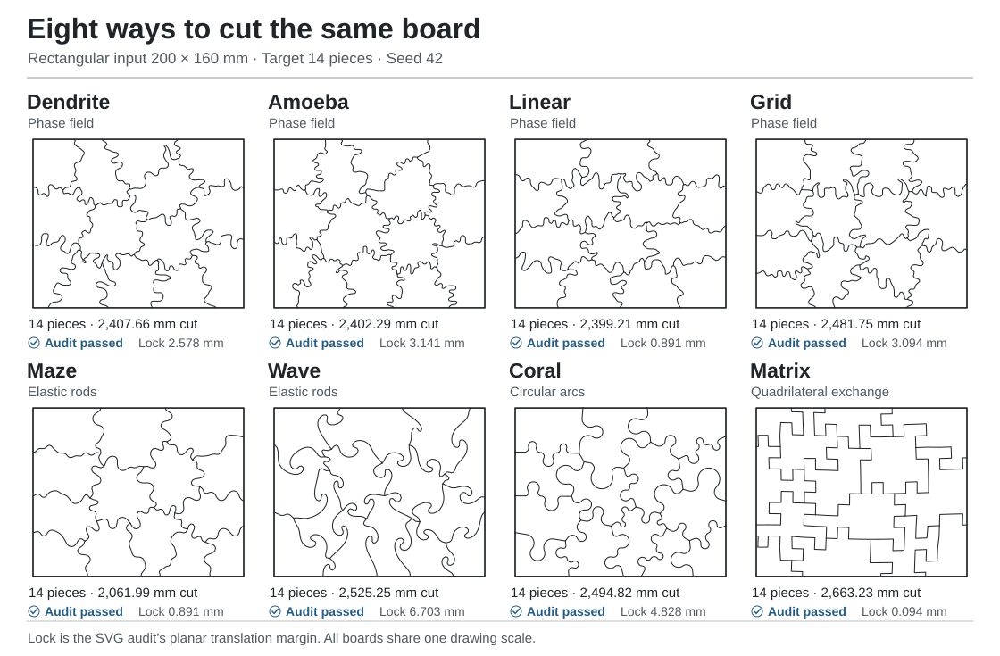

# Generate and verify puzzle geometry

The probe builds a 200 × 160 mm rectangular Wave puzzle with 14 pieces, 45 rod-growth steps and the engraving `WAVE`. The CLI and Formverk server call `generate_puzzle_run`, which selects a solver, then passes the resulting faces and shared seams to the exporter. The Wave example uses a seeded NumPy generator and CPU rod constraints. [Probe](probe_geometry.py) · [Generation entry point](../../dendrite_engine/cli.py) · [Solver dispatch](../../dendrite_engine/solvers.py)

## Cut styles and solver families

| Style | How Formverk constructs the piece boundaries |
| --- | --- |
| Dendrite, Amoeba, Linear, Grid | Grow competing regions on a raster grid, repair disconnected labels and trace the shared boundaries into vectors. The presets choose the initial conditions and growth parameters. [Phase-field presets and solver](../../dendrite_engine/phase_field.py) |
| Maze, Wave | Grow elastic rods on a cell graph. Maze can move its exterior with `borderless=True`. Wave applies a curl field within the supplied perimeter. [Rod solver](../../dendrite_engine/rod_growth.py) |
| Coral | Start with a seeded seam graph. Test tangent circular-arc candidates for each editable seam and retain a candidate when it is simple and its curved body clears nearby cuts. Endpoints, fixed figures and the board perimeter constrain the search. [Circular-arc search](../../dendrite_engine/coral.py) |
| Matrix | Build a quadrilateral mesh inside the perimeter, seed connected groups of cells and exchange boundary cells between neighboring pieces to improve interlocking. Adjacent groups share the same mesh edges. [Quadrilateral mesh and cell exchange](../../dendrite_engine/matrix.py) |

Formverk implements these cut families locally. In the saved `audit.json`, Coral's `metadata.tested_arc_candidates` counts evaluated candidates and `metadata.arc_seams` counts seams reshaped with arcs. Matrix reports the number of mesh cells transferred as `metadata.cell_exchanges`, and records interface counts before and after optimization in `initial_interfaces_over_180_deg` and `interfaces_over_180_deg`. The style registry supplies the CLI choices and the Studio's list of cuts. [Style registry](../../dendrite_engine/styles.py) · [Nervous System source archive](../../resources/nervous-system/README.md)

## Compare all eight exports



Each style received the same 14-piece target, rectangular perimeter and random seed (42). Phase fields ran for 240 CPU steps at 0.8 mm per grid pixel. The rod solvers ran for 45 growth steps with a fixed perimeter. Coral and Matrix used their own default search settings. All eight used a 3 mm neck target and 0.15 mm nominal kerf. Each panel draws the original cut path coordinates on one scale. A common seed makes the comparison reproducible within a solver. Each family uses its own procedure to initialize a board.

All eight exports yielded 14 pieces, with zero duplicate cut segments and zero failures of the neck check. Matrix had the longest path (2,663.23 mm) and the smallest computed lock margin (0.094 mm). Wave's cut was 2,525.25 mm long with a 6.703 mm margin. On this rectangle, total cut length alone gives little indication of how well the seam directions constrain translation. The recorded run used Python 3.11.9, PyTorch 2.14.1, NumPy 1.26.4 and Shapely 2.1.2.

The audit rereads each saved SVG against the supplied rectangle. Cut length includes the perimeter. To estimate interlock, the audit projects shared edges onto 360 translation directions and checks whether the resulting contact graph stays strongly connected in every direction. It searches thresholds up to 12 mm, stopping when the interval is at most 0.0625 mm wide. Values are printed to three decimal places. A score of 12.000 mm reaches the search ceiling. The CSV includes each file’s SHA-256, coverage error, neck failures and solver-specific settings. One seed supplies one observation per style. [Measurements](cut-comparison.csv) · [Comparison script](compare_cuts.py) · [Interlock calculation](../../dendrite_engine/postprocess.py)

```powershell
.\.venv\Scripts\python.exe -m local.technical.compare_cuts --out-parent .\runs\technical
```

The command creates a new directory containing every board’s cut, artwork, previews, puzzle and audit, plus the shared vector plate and CSV.

## Run the probe

From the repository root, using the project environment in PowerShell:

```powershell
.\.venv\Scripts\python.exe -m local.technical.probe_geometry
```

The probe prints a JSON summary and keeps the six files from this run under a new `wave-geometry-*` directory in system temp. Pass `--out-parent .\runs\geometry-probes` to keep successive runs together. Each invocation creates its own child directory. The solver supplies the clearance metadata. The SVG reader independently computes the geometry audit.

In the summary, `clearance_stage` identifies the coordinates or solver stage associated with `min_nonadjacent_clearance_mm`. A `null` snapped-centerline clearance means no eligible segment pair exists. When present, `last_collision_sweep_min_mm` records the retained step's pre-correction sweep minimum, or `null` if no sweep measurement exists. For older reports without a stage field the probe labels the value `legacy_unlabelled`. Those reports stored an in-sweep value and could substitute an initialization value when a measurement was unavailable.


## Call the generator

The Python function returns an `ExportResult` with Shapely polygons and lines, millimetre bounds, an audit dictionary and paths to the written files. This minimal call uses the probe's geometry and engraving settings:

```python
from pathlib import Path
from tempfile import mkdtemp
from dendrite_engine.cli import generate_puzzle_run

run = generate_puzzle_run(
    out_dir=Path(mkdtemp(prefix="wave-api-")),
    style="wave", width_mm=200, height_mm=160, num_pieces=14,
    seed=42, overrides={"growth_steps": 45}, engrave_text="WAVE",
)
print(run.files["cut_svg"], run.audit["all_hard_gates_passed"])
```

The corresponding CLI invocation follows. `generate` exits with 0 on a passing geometry audit and 2 on a failed audit. Open the saved `audit.json` for the per-piece results.

```powershell
$run = Join-Path ([IO.Path]::GetTempPath()) ("wave-cli-" + [guid]::NewGuid().ToString("N"))
.\.venv\Scripts\python.exe -m dendrite_engine generate --style wave --outline rect --width-mm 200 --height-mm 160 --pieces 14 --seed 42 --steps 45 --min-neck-mm 3 --kerf-mm 0.15 --engrave-text WAVE --out $run
```

| Input | Meaning and applicable limits |
| --- | --- |
| `style` | Accepts `dendrite`, `amoeba`, `linear`, `grid`, `maze`, `wave`, `coral` and `matrix`. Each choice routes to the family listed above. |
| `outline_kind`, `width_mm`, `height_mm` | Give positive physical dimensions. A rectangle takes both dimensions. A circle uses the smaller dimension as its diameter. An SVG outline is scaled to the requested width. Exported geometry starts at the upper-left of its bounding box, at (0, 0). |
| `num_pieces`, `seed` | The requested count includes fixed whimsy pieces and must allow at least two ordinary pieces. Verify the realized count in the audit. The Formverk server clamps each board dimension to 80–650 mm and the piece target to 4–240. |
| `--steps`, `--gamma`, `--px-mm` | Python uses `overrides={"growth_steps": n}` for rods and `overrides={"steps": n}` for phase fields. Phase fields also accept `px_mm` in millimetres per grid pixel and `gamma` as a temperature-sensitivity override. Coral and Matrix select their search or mesh settings internally and ignore these three CLI flags for geometry. |
| `kerf_mm`, `min_neck_mm` | Modelled cut width and target minimum material neck, respectively. Defaults are 0.15 mm and 3.0 mm. The SVG reader tests inward offsets at kerfs of 0.10, 0.15, 0.20 and 0.25 mm. |
| `engrave_text` | Text becomes paths in a separate engraving layer. Position is fractional within the bounding box and character height is specified in millimetres. |

## What gets verified

- **Registered SVGs.** `cut.svg` contains the interior seams, exterior and engraving in separate groups. `artwork.svg` colors the piece faces in the same coordinate system. The probe checks their physical dimensions, view boxes and cut layer contents.
- **Geometry on disk.** The probe calls `audit_cut_svg` on the exported paths with the original rectangle as `expected_outline`. It compares every recomputed audit field to the saved report. Supplying the outline makes missing board area observable. The standalone `audit` CLI uses the reconstructed union when it has no expected perimeter.
- **Visual and player outputs.** The probe fully decodes `preview.png` and `pieces_sheet.png`, checks that each contains visible tonal variation, then checks the number of records in `puzzle.json` against the independent SVG piece count.

## Observed result

The Python and CLI runs produced the same cut file with SHA-256 `f3d54c3c06596cebf8a6c2845667ccea1e2cc15c3cdf4e0397dfcf0bedbc66ca` in this environment.

| Check | Measured value |
| --- | --- |
| Cut geometry | 14 pieces, 28 interior paths, 1 perimeter, 6 engraving paths |
| Cut length, excluding engraving | 2,525.25 mm |
| Coverage error and overlap | 0.0 mm² each |
| Duplicate segments, invalid pieces and pieces with holes | 0 each |
| Preview and piece sheet | 1,800 × 1,467 px and 1,050 × 630 px |
| SVG audit | All hard gates passed. The 360-direction planar interlock score was 6.703 mm. |

Wave's settled clearance was **3.050 mm** (`min_nonadjacent_clearance_mm`, stage `snapped_rod_centerlines`). The calculation compares eligible rod segments after rounding to the 0.01 mm grid and before splitting and merging paths. The saved collision sweep recorded **2.723 mm** (`last_collision_sweep_min_mm`) while corrections were still in progress. The 2.8 mm software regression applies to the settled measurement. The independent SVG audit and a physical fit test answer different questions about the exported partition and the material. [Rod solver](../../dendrite_engine/rod_growth.py) · [SVG audit](../../dendrite_engine/postprocess.py) · [Measurement scope and regression fixtures](development.md#how-the-wave-clearance-regression-is-measured)

```powershell
.\.venv\Scripts\python.exe -m pytest tests/test_dendrite_engine.py -q -k rod_growth_non_crossing_and_audit
```
