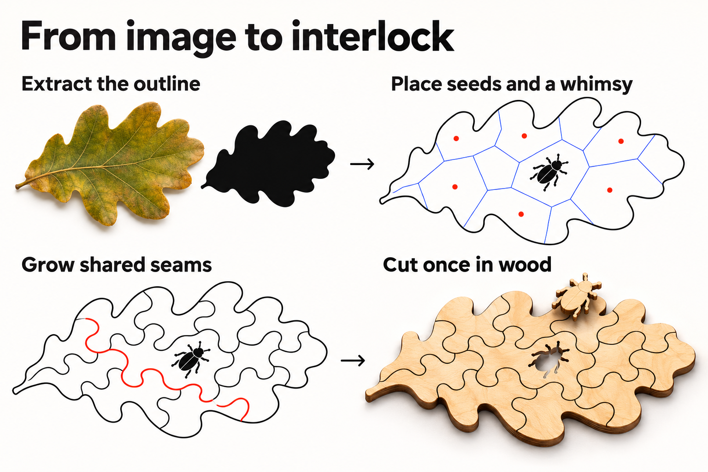
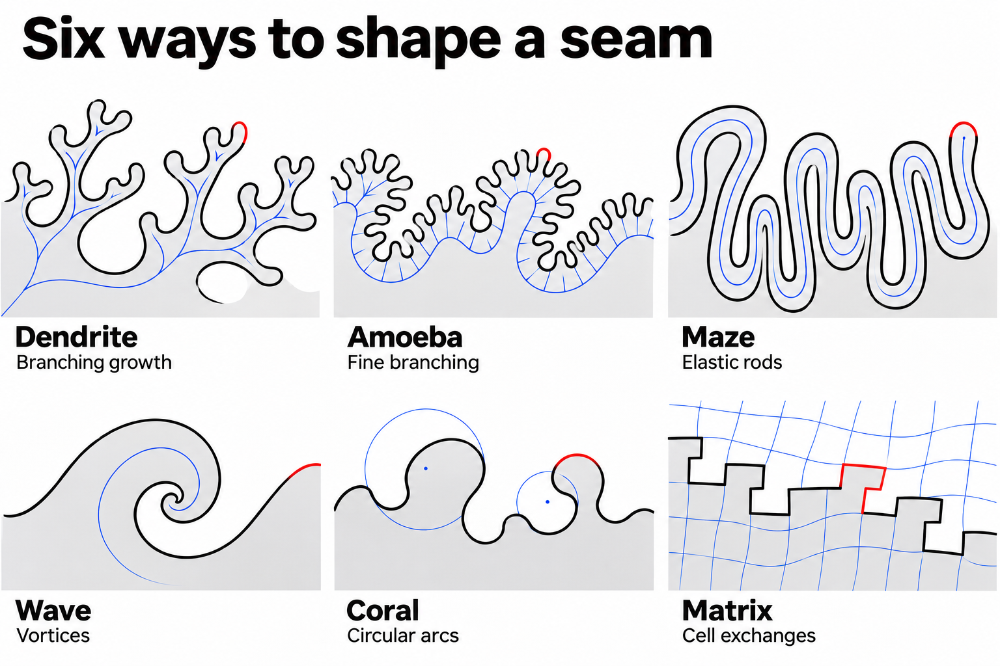
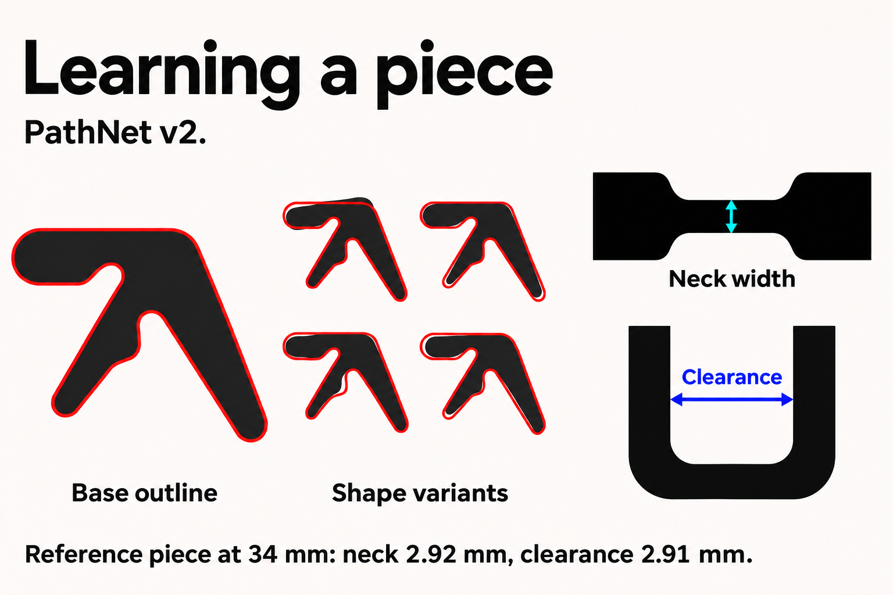
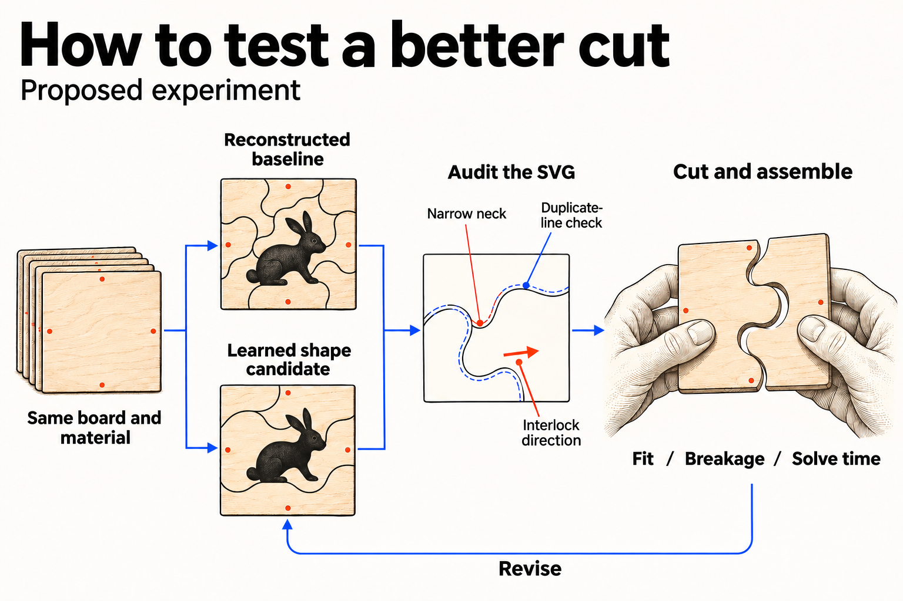
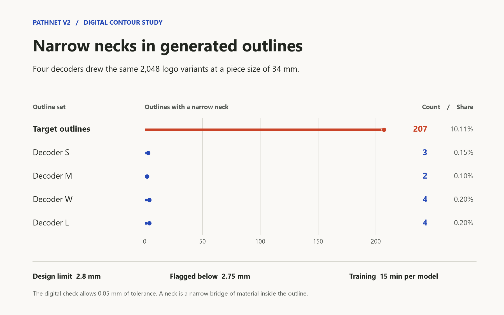
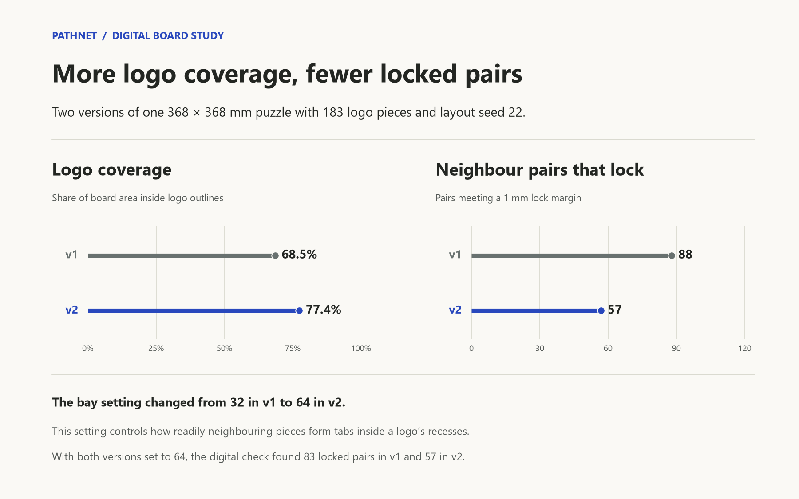

# Growing a wooden jigsaw

How does a photograph become a board full of interlocking pieces? The first two figures illustrate Nervous System’s published process. The others follow our Formverk and PathNet research from a single outline to a proposed test in wood. The companion [architecture guide](../architecture.html) lets you move seeds and inspect how the seams change.

## From a photograph to a shared cut

The leaf supplies the board perimeter. The beetle is a *whimsy*, a recognizable piece whose outline stays fixed while the surrounding cells change shape. Each pair of neighbors shares one cut line. The pictured board is an ImageGen illustration. [Studio process and implementation sources](../README.md)

## Six ways to shape a seam

Dendrite and Amoeba use different settings of the same growth process. Maze lengthens elastic rods. Wave adds vortices to the rods. Coral joins circular arcs. Matrix exchanges cells across a quadrilateral mesh. Each drawing magnifies a characteristic seam so the mechanisms can be compared. [Studio descriptions and photographs](../README.md#how-the-cuts-are-made)

## What the shape model learns

PathNet v2 varies a recognizable motif using 18 shape parameters and outputs a closed cubic spline. The red contour shows the reference. The dark silhouettes illustrate how the arms can move. At 34 mm, the traced reference has a 2.92 mm neck and a 2.91 mm closest gap. The drawings at right show where each measurement is taken. [Model and calibration notes](../../../pathnet/PATHNET_V2.md)

## How to test a better cut

For a paired trial, keep the artwork, board dimensions, piece count, fixed whimsy, seed sites, plywood and laser settings the same. Change how the surrounding seams are generated. Audit both SVGs for duplicate cuts and thin sections. Record breakage per piece, fit at the marked seams and solve time, alternating board order across solvers. This proposed trial compares our baseline reconstruction with our learned candidate. A direct comparison with Nervous System would also require testing physical studio puzzles and recording differences in materials, geometry and difficulty.

## How often a generated outline has a narrow neck

Each decoder evaluated the same 2,048 held-out logo variants at 34 mm. The design minimum is 2.8 mm. With the validator’s 0.05 mm tolerance, it flags a neck strictly below 2.75 mm. It flagged 207 target outlines and 3, 2, 4 and 4 output outlines for decoders S, M, W and L respectively. These are digital measurements of individual shapes. [Data and source-report hashes](05-neck-validation.csv) · [Validation implementation](../../../pathnet/train_v2.py)

## What changes on a whole board

On the 368 mm board with 183 logo pieces and seed 22, the newer design covered more area with recognizable logo silhouettes. Coverage rose from 68.5% to 77.4%, while the number of neighboring pairs that locked at 1 mm fell from 88 to 57. These snapshots compare whole board configurations. They changed both the decoder and the bay setting used to shape interlocks. With the bay setting held at 64, the counts were 83 for v1 and 57 for v2. The result gives the physical trial two outcomes worth checking together. [Comparison data](06-board-tradeoff.csv) · [Board study](../../../pathnet/PATHNET_V2.md)

The first four plates were created with ImageGen. The final two graphs use saved experiment results. [ImageGen prompts and reference-image numbers](imagegen-prompts.json)

[Download the wood-trial kit](../wood-trial/README.md) to test the two bay-64 boards, measure kerf in the stock and compare ten pieces from each of the six Formverk cut families. The kit includes four marked seams on each full board and an offline measurement sheet.
